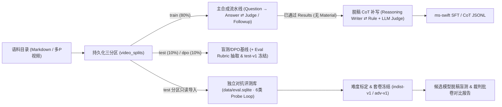

# data-maker

[](package.json)
[](LICENSE)

`data-maker` 是一个基于内置 `node:sqlite` 与无状态 Pi Agent 的模型后训练（SFT / CoT / DPO）数据合成与脱稿对抗评测 CLI。它围绕作者原始文稿完成**多轮问答合成与盲审返工**、**无原稿第一人称思考链（CoT）逆向补写**，以及**物理隔离的六类对抗考题（Probe）盲测与批卷**。领域核心概念见 [术语表（GLOSSARY.md）](GLOSSARY.md)，开源协议为 [MIT](LICENSE)。

---

## 1. 30 秒离线试跑

环境要求：**Node.js >= 22.19.0**（使用内置 `node:sqlite`，无 C++ 原生编译依赖）、npm。

```powershell
npm install
npm run demo
```

`demo` 使用内置固定材料与确定性判断脚本，不调用外部 API、不需要配置密钥，结果写入独立的 `output/demo.sqlite`：

```text
完成：通过 2，跳过 1，耗尽 0，错误 0
```

其中 2 条全部对话轮通过质检的样本写入 `results` 表（自动标记 `training_enabled: false` 防污染正式训练集），第 3 题演示 `drop` 淘汰分支，仅保留在过程表 `run_items` / `attempts` 中。

---

## 2. 为什么不用单次 Prompt 脚本？（设计取舍与边界）

常见的后训练数据脚本通常用单轮 Prompt 直接把文稿转成 `.jsonl` 文件。一旦进入多轮迭代（SFT → CoT 补写 → On-policy DPO → 跨版本盲测），零散 JSONL 文件会迅速遇到四个棘手问题，`data-maker` 针对它们做了专门的架构取舍：

1. **统一 SQLite 真相源，数据库触发器物理防泄漏**（[ADR 0001](docs/adr/0001-unified-sqlite-over-jsonl-files.md)）
   所有视频按归一化 `video_key` 持久化锁定为 `train`（约 80%）、`test`（约 10%）、`dpo`（约 10%）三分区，同一多 P 视频的所有分块强制同区。`video_splits` 表与 `results` 表均挂载不可变触发器；只有 `live` 模式、`train` 分区且全员 `status: ready` 的运行才允许导出为 SFT 训练集，从根源上杜绝盲测题或半截废案混入训练集。
2. **13 个角色全员无状态 Pi Agent + Skill 白名单隔离**（[ADR 0002](docs/adr/0002-isolated-pi-agents-per-role.md)）
   每次模型调用均启动全新的独立 Pi Agent，不共享隐式会话历史。作答角色（`answer`）看不到质检评分细则（`quality-judge`）；第 $N$ 次返工重答时仅传入最新一版草稿与精简修改意见，不携带历史废案；每次运行的系统提示词与 Skill SHA-256 指纹完整快照入库。
3. **脱稿逆向补写 CoT，杜绝“看稿找答案”的阅读理解思维链**（[ADR 0003](docs/adr/0003-blind-cot-backfill-without-source-material.md)）
   在有稿问答阶段直接生成 `<think>` 会导致思考链充满“原文第二段提到……”的摘抄痕迹，而模型上线推理时根本没有原稿。`npm run reasoning` 在不提供 `material` 的前提下，仅凭问题与已通过回答逆向推演第一人称破题骨架，并经过确定性规则（禁上帝视角词、8-gram 重合率 `<= 0.25`、最长连续照抄 `<= 18` 字、思考/回答字数比 `<= 0.8`）与 `reasoning-judge` 双重过滤。
4. **训练与评测双库、双 Skill 物理隔离**（[ADR 0004](docs/adr/0004-physically-isolated-eval-database-and-skills.md)）
   独立评测库 `data/eval.sqlite` 仅以只读方式从主库拉取 `test` 分区文稿快照，使用专属的 `skills/eval/*` 生产 6 类实战对抗题（野生短问、错误前提陷阱、易混辨析、现实迁移、越界幻觉诱导、多轮连续施压）。运行时守卫（[src/eval-guard.ts](src/eval-guard.ts)）禁止训练与评测互读对方 Skill；套卷冻结时自动执行通用模型裸答难度标定与训练集 3-gram Jaccard 相似度审计。

> [!IMPORTANT]
> **明确不做的事（Non-goals）**：
> - **不内置模型训练器**：本工具负责合成与评测数据工程，导出的严格单行 JSONL 直接交由 `ms-swift` 或 `LLaMA-Factory` 执行 SFT / DPO 训练。
> - **不内置 ASR 转写或网页爬虫**：输入需为清洗后的 Markdown 文稿目录或 JSONL 材料（仓库附带标准库清洗脚本 [export_weimingzi.py](scripts/weimingzi/export_weimingzi.py)）。
> - **不是通用 PDF 拖拽切块问答面板**：内置 13 套 Skill 针对“鲜明作者人设、深度理论辨析与第一人称口吻”深度定制；若迁移至其他领域，需替换 `skills/*/SKILL.md` 中的领域规范。

---

## 3. 架构与三条核心流水线



1. **主数据合成流水线**（`data/data-maker.sqlite`，14 张表）：多 P 视频自适应合并/超长按分 P 切块 → 按字数动态配额出题 → 单视频 `30:50:20`（1/2/3 轮）与 `short`/`medium`/`long` 篇幅档位混合问答质检 → 结构化评分要点（`eval_rubrics`）抽取 → 按需导出严格单行训练 JSONL。
2. **脱稿 CoT 逆向补写流水线**（`npm run reasoning`）：分层抽样或全量扫描已通过问答轮次 → 无原稿逆向生成第一人称思考骨架 → 确定性规则 + LLM 语义质检 → 导出 `ms-swift` 的 `reasoning_content` 或 `<think>` 内联格式（默认 `--expand-turns` 按轮展开，仅末轮带 CoT）。
3. **独立对抗评测流水线**（`data/eval.sqlite`，11 张表，`npm run eval`）：`ProbeWriter ⇄ ProbeCritic` 审题 → `ReferenceGenerator ⇄ ReferenceVerifier` 原稿核验（多轮 `pressure` 题型由 `AdversaryFollowup` 驱动最多 3 轮高压追问）→ `RubricExtractorV2` 评分卡 → 通用模型裸答难度标定（`easy`/`medium`/`hard`）→ 套卷冻结（`indist-v1` / `adv-v1`）→ 候选模型脱稿作答、行为闸门批卷与跨版本对比报告。

---

## 4. 配置模型环境（`.env`）

复制 [.env.example](.env.example) 为本地 `.env`（已被 `.gitignore` 排除，凭据永不入库）：

```powershell
if (-not (Test-Path .env)) { Copy-Item .env.example .env }
```

填写 OpenAI Chat Completions 兼容接口参数：

```dotenv
LLM_BASE_URL=https://YOUR_API_HOST/v1
LLM_MODEL=YOUR_MODEL_ID
LLM_API_KEY=YOUR_API_KEY
LLM_THINKING_LEVEL=high
LLM_CONTEXT_WINDOW=1048576
LLM_MAX_TOKENS=65536
LLM_TIMEOUT_MS=180000
```

支持按流水线或按角色细粒度覆盖模型与思考强度（未设置时自动继承 `LLM_*`）：

| 作用域 | 可选环境变量 | 用途 |
| --- | --- | --- |
| 主流水线角色思考强度 | `LLM_{QUESTION,ANSWER,JUDGE,FOLLOWUP,RUBRIC}_THINKING_LEVEL` | 按角色设为 `off` / `minimal` / `low` / `medium` / `high` / `xhigh` |
| CoT 补写角色 | `REASONING_{BASE_URL,MODEL,API_KEY,THINKING_LEVEL,TIMEOUT_MS}` | 独立指定 `reasoning-writer` 模型 |
| CoT 质检角色 | `REASONING_JUDGE_{BASE_URL,MODEL,API_KEY,THINKING_LEVEL,TIMEOUT_MS}` | 独立指定 `reasoning-judge` 模型（未设时回退 `REASONING_*` → `LLM_*`） |
| 独立对抗评测角色 | `EVAL_LLM_{BASE_URL,MODEL,API_KEY,THINKING_LEVEL,TIMEOUT_MS}` | 独立指定评测出题、核验、裸答标定与批卷裁判模型 |
| 被测候选模型 | `CANDIDATE_LLM_{BASE_URL,MODEL,API_KEY,TIMEOUT_MS}` | `npm run eval -- run` 脱稿盲测时的默认候选模型接口 |

---

## 5. 常用命令速查

完整的日常生产、实时进度排查 SQL 与故障恢复手册见 [生产操作手册（docs/production-workflow.md）](docs/production-workflow.md)。

### 5.1 主数据合成与三分区导出（`npm run batch` / `export`）

```powershell
# 查看语料库 train / test / dpo 三分区进度与待质检题数（离线，不调用模型）
npm run batch -- --status

# 一键生产 SFT 训练集（默认 --split train，自动跳过已处理视频，10 并发出题+问答质检，异常自动重试 3 次）
npm run batch -- --limit 10 --shuffle --export output/train-batch.jsonl

# 生产 test 分区同分布盲测集 + 抽取每轮结构化评分卡 (--extract-rubric) + 冻结不可变版本 test-v1
npm run batch -- --split test --limit 10 --shuffle --extract-rubric --freeze-version test-v1 --export output/test-v1.jsonl

# 生产 dpo 分区 On-policy 采题池（与 test 分区物理隔离）
npm run batch -- --split dpo --limit 10 --shuffle --extract-rubric --export output/dpo-pool.jsonl

# 汇总导出全库所有正式 train 样本，并按整视频分组切出 10% 验证集 + 审计清单
npm run export -- --all-formal --dedup latest --shuffle --seed 42 --out output/train.jsonl --val-out output/val.jsonl --val-ratio 0.1 --manifest output/manifest.json
```

也可分步调用 [src/question-cli.ts](src/question-cli.ts)（`npm run questions`）、[src/judge-cli.ts](src/judge-cli.ts)（`npm run judge -- --only-unjudged`）或单文件组合入口 [src/cli.ts](src/cli.ts)（`npm start`）。

### 5.2 脱稿 CoT 思考链逆向补写（`npm run reasoning`）

```powershell
# 查看已通过问答轮次与 CoT 补写覆盖统计
npm run reasoning -- --status

# 抽取 30 轮平衡样本（自动均衡 short/medium/long、turn 1/2/3 与不同视频），并发补写 + 双重质检 + 导出 ms-swift JSONL 与人工审阅稿
npm run reasoning -- --pilot 30 --concurrency 10 --seed 42 --format reasoning_content --expand-turns --export output/train-cot-pilot30.jsonl --review-md output/cot-review-pilot30.md

# 全量跑完剩余未补写轮次，或离线从指定批次导出（--export-only）
npm run reasoning -- --all --concurrency 15 --export output/train-cot-all.jsonl
```

### 5.3 独立评测库与对抗盲测流水线（`npm run eval`）

```powershell
# 1. 初始化独立评测库 data/eval.sqlite，并将主库 test-v1 只读镜像为同分布基准卷 indist-v1
npm run eval -- init
npm run eval -- mirror --from-version test-v1 --as indist-v1

# 2. 从主库 test 分区只读导入未用视频快照，并运行 6 类对抗考题 Probe Loop
npm run eval -- import --limit 10 --shuffle --seed 42 --exclude-used
npm run eval -- build --videos imported --probes-per-video 8 --concurrency 8 --call-attempts 3

# 3. 通用模型无原稿裸答难度标定（easy / medium / hard）并冻结对抗套卷 adv-v1
npm run eval -- calibrate --run all --concurrency 8 --out output/eval/calibration-report.md
npm run eval -- freeze --name adv-v1 --max-easy-ratio 0.2 --export output/eval/adv-v1.jsonl --manifest-out output/eval/adv-v1.manifest.json

# 4. 对候选模型执行脱稿盲测（支持 gold / self 多轮历史模式）、裁判批卷与跨模型对比报告
npm run eval -- run --suite adv-v1 --candidate sft-v1 --model my-sft --base-url http://127.0.0.1:8000/v1 --history-mode gold
npm run eval -- grade --run latest --concurrency 8
npm run eval -- compare --baseline base --target sft-v1 --suites indist-v1,adv-v1 --out output/eval/compare-base-vs-sft.md
```

### 5.4 上游文稿无损清洗与旧库迁移

```powershell
# 从上游只读文稿仓无损清洗并按 BV 号导出 Markdown 语料目录（Python 3.12+ 标准库）
python scripts/weimingzi/export_weimingzi.py --source data/weimingzi-source --output data/weimingzi-semantic

# 将早期原型库与试跑目录幂等迁移至 data/data-maker.sqlite
npm run migrate
```

---

## 6. 13 角色提示词与独立 Skill 矩阵

所有角色均遵循“系统提示词定协议 + 独立 Skill 定策略/风格/标准”，全部默认 Skill 已达 `status: ready`，并由双向白名单守卫强制隔离：

| 流水线 | 角色 | 系统提示词 | 默认 Skill（`status: ready`） | 注入标签 |
| --- | --- | --- | --- | --- |
| 主数据与盲测基线 | 出题 `question` | [prompts/question.md](prompts/question.md) / [prompts/question-generator.md](prompts/question-generator.md) | [skills/question-design/SKILL.md](skills/question-design/SKILL.md) | `<question-design>` |
| 主数据与盲测基线 | 追问 `followup` | [prompts/followup.md](prompts/followup.md) | [skills/followup-strategy/SKILL.md](skills/followup-strategy/SKILL.md) | `<followup-strategy>` |
| 主数据与评测共享 | 回答 `answer` | [prompts/answer.md](prompts/answer.md) | [skills/answer-style/SKILL.md](skills/answer-style/SKILL.md) | `<answer-style>` |
| 主数据与盲测基线 | 质检 `judge` | [prompts/judge.md](prompts/judge.md) | [skills/quality-judge/SKILL.md](skills/quality-judge/SKILL.md) | `<judging-skill>` |
| 主数据与盲测基线 | 要点 `rubric` | [prompts/rubric.md](prompts/rubric.md) | [skills/eval-rubric/SKILL.md](skills/eval-rubric/SKILL.md) | `<eval-rubric>` |
| 脱稿 CoT 逆向补写 | 思考补写 `reasoning-writer` | [prompts/reasoning-writer.md](prompts/reasoning-writer.md) | [skills/reasoning-writer/SKILL.md](skills/reasoning-writer/SKILL.md) | `<reasoning-writer>` |
| 脱稿 CoT 逆向补写 | 思考质检 `reasoning-judge` | [prompts/reasoning-judge.md](prompts/reasoning-judge.md) | [skills/reasoning-judge/SKILL.md](skills/reasoning-judge/SKILL.md) | `<reasoning-judge>` |
| 独立对抗评测 | 对抗出题 `probe-writer` | [prompts/eval/probe-writer.md](prompts/eval/probe-writer.md) | [skills/eval/probe-design/SKILL.md](skills/eval/probe-design/SKILL.md) | `<probe-design>` |
| 独立对抗评测 | 考题审题 `probe-critic` | [prompts/eval/probe-critic.md](prompts/eval/probe-critic.md) | [skills/eval/probe-critic/SKILL.md](skills/eval/probe-critic/SKILL.md) | `<probe-critic>` |
| 独立对抗评测 | 对抗参考回答 `reference` | [prompts/eval/reference.md](prompts/eval/reference.md) | [skills/answer-style/SKILL.md](skills/answer-style/SKILL.md) + [skills/eval/probe-answer/SKILL.md](skills/eval/probe-answer/SKILL.md) | `<answer-style>` + `<probe-answer>` |
| 独立对抗评测 | 原稿核验 `verifier` | [prompts/eval/verifier.md](prompts/eval/verifier.md) | [skills/eval/reference-verifier/SKILL.md](skills/eval/reference-verifier/SKILL.md) | `<reference-verifier>` |
| 独立对抗评测 | 多轮施压 `adversary` | [prompts/eval/adversary.md](prompts/eval/adversary.md) | [skills/eval/adversary-tactics/SKILL.md](skills/eval/adversary-tactics/SKILL.md) | `<adversary-tactics>` |
| 独立对抗评测 | 评分卡 v2 `rubric-v2` | [prompts/eval/rubric-v2.md](prompts/eval/rubric-v2.md) | [skills/eval/eval-rubric-v2/SKILL.md](skills/eval/eval-rubric-v2/SKILL.md) | `<eval-rubric-v2>` |
| 独立对抗评测 | 盲测批卷 `eval-grader` | [prompts/eval/grader.md](prompts/eval/grader.md) | [skills/eval/eval-grader/SKILL.md](skills/eval/eval-grader/SKILL.md) | `<eval-grader>` |

---

## 7. 项目状态、验证与文档地图

**当前状态**：`v0.1.0`（活跃维护）。主库 14 张表、独立评测库 11 张表与上述三条核心流水线均已全量落地并通过自动化回归测试。

```powershell
# 运行 TypeScript 类型检查 + 116 项单元与集成测试
npm run check

# 运行 Python 语料无损清洗脚本的 20 项单元测试
python -m unittest discover -s scripts/weimingzi
```

### 文档地图

- **领域模型与架构决策（Domain Model & ADRs）**
  - [GLOSSARY.md](GLOSSARY.md)：领域通用语言（语料与分区、问答合成与质检、脱稿思考补写、对抗盲测与独立评测）。
  - [ADR 0001](docs/adr/0001-unified-sqlite-over-jsonl-files.md)：统一 SQLite 真相源与 JSONL 按需导出投影。
  - [ADR 0002](docs/adr/0002-isolated-pi-agents-per-role.md)：每角色独立无状态 Pi Agent 与 Skill 白名单隔离。
  - [ADR 0003](docs/adr/0003-blind-cot-backfill-without-source-material.md)：脱稿逆向补写 CoT 与反阅读理解泄漏校验。
  - [ADR 0004](docs/adr/0004-physically-isolated-eval-database-and-skills.md)：独立评测库 `data/eval.sqlite` 与训练侧双向物理隔离。
- **架构与设计规范**
  - [SQLite 统一存储设计（docs/sqlite-design.md）](docs/sqlite-design.md)：主库 14 表 DDL、触发器不变量、事务恢复与 JSONL 导出规范。
  - [测试集与评测流水线设计（docs/test-and-eval-pipeline.md）](docs/test-and-eval-pipeline.md)：`train` / `test` / `dpo` 持久化三分区、`eval_rubrics` 与 `test-v1` 基线。
  - [对抗测试集与独立评测库设计（docs/eval-probe-pipeline.md）](docs/eval-probe-pipeline.md)：`data/eval.sqlite` 11 表、6 类对抗 Probe Loop、难度标定、`indist-v1` / `adv-v1` 双卷冻结与候选模型批卷对比。
- **日常操作与调研备忘**
  - [生产操作手册（docs/production-workflow.md）](docs/production-workflow.md)：日常批量生产、进度排查 SQL、增量补跑、CoT 补写与对抗盲测完整手册。
  - [后训练推进备忘（docs/post-training-notes.md）](docs/post-training-notes.md)：SFT 多样性配额、CoT 规格与 On-policy DPO 路线。
  - [Pi Agent 循环调研](docs/research/pi-agent-loop.md) · [同类数据合成项目对比](docs/research/related-data-generation-projects.md) · [早期单表原型归档](docs/question-database.md)。

---

## 8. 开源协议

本项目基于 [MIT License](LICENSE) 开源。
