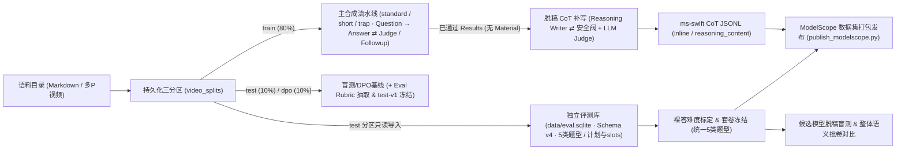

# pi-posttrain-loop

[](package.json)
[](LICENSE)
[](https://www.modelscope.cn/datasets/chosenecho/vmz-sft-cot-eval)
[](https://www.modelscope.cn/models/chosenecho/qwen3.8-27b-sft-cot-vmz-r2-ep15-fp8)
[](https://www.modelscope.cn/models/chosenecho/qwen3.8-27b-sft-cot-vmz-r2-ep20-fp8)

`pi-posttrain-loop` 是一个基于内置 `node:sqlite` 与无状态 Pi Agent 循环的模型后训练（SFT / CoT / DPO）数据合成与脱稿对抗评测 CLI。它围绕作者原始文稿完成**九种风格与工具预设的多轮问答合成与盲审返工**、**无原稿第一人称思考链（CoT）逆向补写**，以及**物理隔离的对抗/陷阱考题（Probe）盲测、难度标定与整体语义批卷**。领域核心概念见 [术语表（GLOSSARY.md）](GLOSSARY.md)，开源协议为 [MIT](LICENSE)。

> **公开产出（ModelScope）**：
> - **数据集（SFT / CoT 训练集与评测集）**：[chosenecho/vmz-sft-cot-eval](https://www.modelscope.cn/datasets/chosenecho/vmz-sft-cot-eval)
> - **模型权重（ep1.5 Checkpoint，FP8）**：[chosenecho/qwen3.8-27b-sft-cot-vmz-r2-ep15-fp8](https://www.modelscope.cn/models/chosenecho/qwen3.8-27b-sft-cot-vmz-r2-ep15-fp8)
> - **模型权重（ep2.0 Checkpoint，FP8）**：[chosenecho/qwen3.8-27b-sft-cot-vmz-r2-ep20-fp8](https://www.modelscope.cn/models/chosenecho/qwen3.8-27b-sft-cot-vmz-r2-ep20-fp8)

---

## 1. 30 秒离线试跑

环境要求：**Node.js >= 22.19.0**（使用内置 `node:sqlite`，无 C++ 原生编译依赖）、npm。

```powershell
npm install
npm run dm -- demo
```

`demo` 使用内置固定材料与确定性判断脚本，不调用外部 API、不需要配置密钥，结果写入独立的 `output/demo.sqlite`（可通过 `npm run dm -- presets` 随时查看全部内置任务预设）。其中 2 条全部对话轮通过质检的样本写入 `results` 表（自动标记 `training_enabled: false` 防污染正式训练集），第 3 题演示 `drop` 淘汰分支，仅保留在过程表 `run_items` / `attempts` 中。

---

## 2. 为什么不用单次 Prompt 脚本？（设计取舍与边界）

常见的后训练数据脚本通常用单轮 Prompt 直接把文稿转成 `.jsonl` 文件。一旦进入多轮迭代（SFT → CoT 补写 → On-policy DPO → 跨版本盲测），零散 JSONL 文件会迅速遇到四个棘手问题，`pi-posttrain-loop` 针对它们做了专门的架构取舍：

1. **统一 SQLite 真相源，数据库触发器物理防泄漏**（[ADR 0001](docs/adr/0001-unified-sqlite-over-jsonl-files.md)）
   所有视频按归一化 `video_key` 持久化锁定为 `train`（约 80%）、`test`（约 10%）、`dpo`（约 10%）三分区，同一多 P 视频的所有分块强制同区。`video_splits` 表与 `results` 表均挂载不可变触发器；只有 `live` 模式、`train` 分区且全员 `status: ready` 的运行才允许导出为 SFT 训练集，从根源上杜绝盲测题或半截废案混入训练集。
2. **各角色独立 Pi Agent + Skill 白名单隔离**（[ADR 0002](docs/adr/0002-isolated-pi-agents-per-role.md)）
   每次模型调用均启动全新的独立 Pi Agent，不共享隐式会话历史。作答角色（`answer`）看不到质检评分细则（`quality-judge`）；第 $N$ 次返工重答时仅传入最新一版草稿与精简修改意见，不携带历史废案；多轮长度、收束时机与风格分工完全交由按预设切换的专属 Skill 与自主追问 Agent 驱动，不再堆砌脆弱的静态正则与机械配比；每次运行的系统提示词与 Skill SHA-256 指纹完整快照入库。
3. **脱稿逆向补写 CoT，杜绝“看稿找答案”与“正文浓缩摘要”式思维链**（[ADR 0003](docs/adr/0003-blind-cot-backfill-without-source-material.md)）
   在有稿问答阶段直接生成 `<think>` 会导致思考链充满“原文第二段提到……”的摘抄痕迹，而把 `<think>` 写成答案缩写则会诱发模型在正文两段草草收尾。`npm run dm -- cot` 在不提供 `material` 的前提下，仅凭问题、前序对话与已通过回答逆向生成第一人称开口前思考骨架；程序层仅保留极简工程安全阀（非空、禁原稿/录播/规则等硬泄漏词、禁 `<think>`/Markdown/列表格式脏污、异常超长熔断 `<= 800` 字、连续照抄熔断 `< 36` 字），将自然度、去摘要化与边界一致性交由 `reasoning-judge` 主导裁决。
4. **训练与评测双库、双 Skill 物理隔离**（[ADR 0004](docs/adr/0004-physically-isolated-eval-database-and-skills.md)）
   独立评测库 `data/eval.sqlite`（Schema v4）仅以只读方式从主库拉取 `test` 分区文稿快照，使用专属 `skills/eval/*` 生产统一 5 类考题，以完整计划和 slots 保存断点。运行时守卫（[src/synth/eval-guard.ts](src/synth/eval-guard.ts)、[src/eval/eval-prompts.ts](src/eval/eval-prompts.ts)）禁止训练与评测互读对方 Skill；套卷冻结时检查运行状态、`split = 'test'`、难度占比和训练集 2-gram 相似度，批卷采用整体语义评分（实质分与风格分独立）。

> [!IMPORTANT]
> **明确不做的事（Non-goals）**：
> - **不内置模型训练器**：本工具负责合成、评测与数据集打包工程，导出的严格单行 JSONL 直接交由 `ms-swift` 或 `LLaMA-Factory` 执行 SFT / DPO 训练。
> - **不内置 ASR 转写或网页爬虫**：输入需为清洗后的 Markdown 文稿目录或 JSONL 材料（仓库附带标准库清洗脚本 [export_weimingzi.py](scripts/weimingzi/export_weimingzi.py)）。
> - **不是通用 PDF 拖拽切块问答面板**：内置 28 份 Skill 针对“鲜明作者人设、深度理论辨析、短答快问与陷阱拒答”深度定制；若迁移至其他领域，需替换 `skills/*/SKILL.md` 中的领域规范。

---

## 3. 架构与三条核心流水线



1. **主数据合成流水线**（`npm run dm -- synth`，`data/data-maker.sqlite`，14 张表）：多 P 视频自适应合并/超长按分 P 切块 → `--sort core-first` 核心理论课优先或 `--shuffle` 抽选 → 按字数动态紧凑配额（2–6 题）出题 → 支持 `--profile standard | short | trap` 三套专职 Skill 预设（及一键 `--preset train-standard | train-short | train-trap | test-freeze | dpo-pool`），由 `followup` Agent 自主决定继续追问或收束 → 可选抽取结构化评分要点（`eval_rubrics`）→ 按需导出严格单行训练 JSONL（支持 `--preset train-val`、`--timestamp`、按视频整块切验证集与 `--manifest`）。
2. **脱稿 CoT 逆向补写流水线**（`npm run dm -- cot`）：支持按 `--profile all|standard|short` 与 `--tier short,medium,long` 过滤、分层均衡抽样（`--preset pilot` / `--limit N --stratified`）或增量补齐（`--preset full` / `--only-missing`）→ 无原稿逆向生成第一人称思考骨架 → 极简工程安全阀 + `reasoning-judge` 双关过滤 → 默认导出 `ms-swift 4.6.0` 所需的 `--format inline`（`<think>...</think>` 内联；也支持 `--format reasoning_content` 直调 HF `apply_chat_template`），默认按轮展开（历史轮纯正文，仅末轮带 CoT，配 `--loss_scale last_round`）。
3. **独立盲测评测流水线**（`npm run dm -- eval`，`data/eval.sqlite`，Schema v4，完整计划与 slots）：统一 5 类题型（`answer` / `correct_premise` / `acknowledge_gap` / `refuse` / `hold_position`，题型即首轮预期行为）；一键 `eval make` 串联只读导入 `test` 分区 → `ProbeWriter` 自主规划 0–N 题 → `ProbeCritic` 静态审题与语义去重 → `Reference ⇄ Verifier` 原稿核验并**同步产出评分卡**（`hold_position` 第 2–3 轮由 `Adversary` 施压）→ 通用模型无原稿裸答难度标定（`easy`/`medium`/`hard`）→ 套卷冻结（自动控制 `easy` 占比上限、跨库分区复核与训练集 2-gram 相似度审计）；一键 `eval evaluate` 串联候选模型脱稿作答、整体语义批卷（行为失守或幻觉封顶 40 分）与跨模型对比报告。

代码目录按业务域物理分层，零循环依赖、非 Store 模块零裸 SQL，并通过自动化架构守卫（[test/architecture.test.ts](test/architecture.test.ts)）持续验证：

- `src/cli/`：统一单入口 CLI（`index.ts` 路由至 `synth.ts` / `cot.ts` / `eval.ts`）
- `src/synth/`：主问答合成域（`workflows.ts` / `presets.ts` / `skills.ts` / `corpus.ts` / `dialogue-loop.ts` / `store/*`）
- `src/reasoning/`：脱稿 CoT 补写域（`workflows.ts` / `presets.ts` / `engine.ts` / `checks.ts` / `export.ts` / `store.ts`）
- `src/eval/`：物理隔离评测域（`workflows.ts` / `probe-loop.ts` / `calibrate.ts` / `suite-freeze.ts` / `eval-runner.ts` / `eval-grader.ts` / `inspect.ts` / `report.ts` / `store/*`）
- `src/shared/`：底层叶子工具（`pi-runner.ts` / `concurrency.ts` / `retry.ts` / `schema.ts` / `skill-loader.ts` / `cli-helpers.ts` / `paths.ts` / `utils.ts`）

---

## 4. 配置模型环境（`.env`）

复制 [.env.example](.env.example) 为本地 `.env`（已被 `.gitignore` 排除，凭据永不入库）：

```powershell
if (-not (Test-Path .env)) { Copy-Item .env.example .env }
```

填写 OpenAI Chat Completions 兼容接口参数：

```dotenv
LLM_BASE_URL=https://YOUR_API_HOST/v1
LLM_MODEL=YOUR_MODEL_ID
LLM_API_KEY=YOUR_API_KEY
LLM_THINKING_LEVEL=high
LLM_CONTEXT_WINDOW=1048576
LLM_MAX_TOKENS=65536
LLM_TIMEOUT_MS=180000
```

支持按流水线或角色覆盖模型、思考强度与候选系统提示词。密钥仅在规范化后的 API 根地址相同时继承；切换服务须显式配置专用密钥，详见[地址与密钥绑定](docs/production-workflow.md#模型服务地址与密钥的绑定)。

| 作用域 | 可选环境变量 | 用途 |
| --- | --- | --- |
| 主流水线角色思考强度 | `LLM_{QUESTION,ANSWER,JUDGE,FOLLOWUP}_THINKING_LEVEL` | 按角色设为 `off` / `low` / `medium` / `high` / `max` |
| CoT 补写角色 | `REASONING_{BASE_URL,MODEL,API_KEY,THINKING_LEVEL,MAX_TOKENS,TIMEOUT_MS}` | 独立指定 `reasoning-writer` 模型 |
| CoT 质检角色 | `REASONING_JUDGE_{BASE_URL,MODEL,API_KEY,THINKING_LEVEL,TIMEOUT_MS}` | 独立指定 `reasoning-judge` 模型（未设时回退 `REASONING_*` → `LLM_*`） |
| 独立评测角色 | `EVAL_LLM_{BASE_URL,MODEL,API_KEY,THINKING_LEVEL,TIMEOUT_MS}` | 独立指定评测出题、核验与批卷裁判模型 |
| 被测候选模型 | `CANDIDATE_LLM_{BASE_URL,MODEL,API_KEY,MAX_TOKENS,TIMEOUT_MS}` | `npm run dm -- eval evaluate` 脱稿盲测时的默认候选模型接口 |
| 候选模型系统提示词 | `CANDIDATE_LLM_SYSTEM_PROMPT` / `CANDIDATE_LLM_SYSTEM_PROMPT_FILE` | 覆盖 `eval evaluate` 默认加载的 `prompts/eval/candidate-system.md`（可用 `--no-system-prompt` 关闭） |

---

## 5. 常用命令速查（统一入口 `npm run dm`）

所有命令均收敛在统一入口 `npm run dm -- <synth|cot|eval|demo|presets>` 下，内置常用任务预设（任何显式参数均可覆盖预设字段），随时运行 `npm run dm -- presets` 查看完整预设清单。完整的生产排查 SQL 与故障恢复手册见 [生产操作手册（docs/production-workflow.md）](docs/production-workflow.md)。

### 5.1 主数据合成与三分区导出（`npm run dm -- synth`）

```powershell
# 只读查看三分区进度、待同步分区数与待质检题数（不建库，不调用模型）
npm run dm -- synth status

# 按预设生产训练样本；全部 9 种 profile 可通过 presets 查看
npm run dm -- synth run --preset train-standard --limit 20 --export output/train-batch.jsonl
npm run dm -- synth run --preset train-short --limit 20 --export output/train-short.jsonl
npm run dm -- synth run --preset train-trap --limit 20 --export output/train-trap.jsonl
npm run dm -- synth run --preset train-todo --limit 5 --export output/train-todo.jsonl
npm run dm -- synth run --preset train-clarify --limit 5 --export output/train-clarify.jsonl

# suite 默认依次跑 8 种 profile；可指定子集
npm run dm -- synth suite --profiles short,medium,long,xlong,trap,search,todo,clarify --limit 5

# 生产 dpo 分区 On-policy 采题池（与 test 分区物理隔离；synth 禁止在 test 分区生产）
npm run dm -- synth run --preset dpo-pool --limit 10 --export output/dpo-pool.jsonl

# 汇总导出全库所有正式 train 样本，按整视频切出 10% 验证集 + 时间戳 + 审计清单
npm run dm -- synth export --preset train-val --out output/train.jsonl --val-out output/val.jsonl --manifest output/manifest.json
```

也可分步调用 `npm run dm -- synth questions`（单独出题）或 `npm run dm -- synth judge --only-unjudged --profile todo`（补跑指定 profile）。合成支持 `standard`、`short`、`medium`、`long`、`xlong`、`trap`、`search`、`todo`、`clarify`；默认轮数和工具策略见[当前架构](docs/architecture.md)。

### 5.2 脱稿 CoT 思考链逆向补写（`npm run dm -- cot`）

```powershell
# 查看已通过问答轮次、来源 profile、长度档位与历史补写运行
npm run dm -- cot status

# 30 轮分层试点（内置 pilot 预设），并发补写 + 双重质检 + 导出 inline JSONL 与人工审阅稿
npm run dm -- cot backfill --preset pilot --export output/cot-pilot.jsonl --review-md output/cot-pilot-review.md --manifest output/cot-pilot-manifest.json

# 全量增量补写剩余未通过轮次（可按 --profile 或 --tier long 过滤）
npm run dm -- cot backfill --preset full --export output/train-cot.jsonl --val-out output/val-cot.jsonl --val-ratio 0.05 --shuffle --seed 42 --manifest output/train-cot-manifest.json

# 离线从指定 reasoning_run 导出（默认 inline + 按轮展开适配 ms-swift 4.6.0；直调 HF 可选 --format reasoning_content）
npm run dm -- cot export --preset train-cot --reasoning-run 2 --out output/train-cot.jsonl --review-md output/cot-review.md
```

### 5.3 独立评测库与盲测流水线（`npm run dm -- eval`）

```powershell
# 1. 一键造卷（导入 test 分区 → 5 类题型出题核验 → 裸答难度标定 → 冻结套卷；可断点续跑）
npm run dm -- eval make --suite eval-v1 --export output/eval/eval-v1.jsonl --manifest-out output/eval/eval-v1.manifest.json

# 只造题标定不冻结（增量构建），或查看已冻结套卷与评测库状态
npm run dm -- eval make --no-freeze --limit 10
npm run dm -- eval suites
npm run dm -- eval inspect --sample 10 --out output/eval/inspect.md

# 2. 一键盲测（候选模型脱稿作答 + 整体语义批卷 + 可选直接出报告；默认 gold 历史，可选 --history-mode self）
npm run dm -- eval evaluate --suite eval-v1 --candidate sft-v1 --model my-sft --base-url http://127.0.0.1:8000/v1 --api-key EMPTY --out output/eval/sft-v1.md
npm run dm -- eval compare --baseline base --target sft-v1 --suites eval-v1 --out output/eval/compare-base-vs-sft.md
```

### 5.4 上游清洗与 ModelScope 数据集发布

本项目基于上述流水线产出的公开资源：
- **训练集与评测集**：[ModelScope · chosenecho/vmz-sft-cot-eval](https://www.modelscope.cn/datasets/chosenecho/vmz-sft-cot-eval)
- **微调模型权重（ep1.5 Checkpoint，FP8）**：[ModelScope · chosenecho/qwen3.8-27b-sft-cot-vmz-r2-ep15-fp8](https://www.modelscope.cn/models/chosenecho/qwen3.8-27b-sft-cot-vmz-r2-ep15-fp8)
- **微调模型权重（ep2.0 Checkpoint，FP8）**：[ModelScope · chosenecho/qwen3.8-27b-sft-cot-vmz-r2-ep20-fp8](https://www.modelscope.cn/models/chosenecho/qwen3.8-27b-sft-cot-vmz-r2-ep20-fp8)

```powershell
# 从上游只读文稿仓无损清洗并按 BV 号导出 Markdown 语料目录（Python 3.12+ 标准库）
python scripts/weimingzi/export_weimingzi.py --source data/weimingzi-source --output data/weimingzi-semantic

# 校验、脱敏并打包 CoT 训练集与冻结评测集（生成 Dataset Card 与 SHA256SUMS.txt），按需发布到 ModelScope
python scripts/publish_modelscope.py prepare --release-dir output/modelscope-release --repo-id <namespace>/<dataset>
python scripts/publish_modelscope.py upload --repo-id <namespace>/<dataset> --release-dir output/modelscope-release --dry-run
```

---

## 6. 角色提示词与多预设 Skill 矩阵

所有角色均遵循“系统提示词定协议 + 独立 Skill 定策略/风格/标准”。仓库内置 **44 份 `SKILL.md`**，全部为 `status: ready`：9 个合成 profile 各 4 份、CoT 2 份、独立评测 6 份。训练与评测通过双向白名单守卫隔离；评测参考答案仅复用基础口吻规范。

| 流水线 | 角色 | 系统提示词 | 默认 Skill（`status: ready`） | 风格预设变体 Skill | 注入标签 |
| --- | --- | --- | --- | --- | --- |
| 主数据合成 | 出题 `question` | [prompts/question.md](prompts/question.md) / [prompts/question-generator.md](prompts/question-generator.md) | [skills/question-design/SKILL.md](skills/question-design/SKILL.md) | [short](skills/short/question-design/SKILL.md) · [medium](skills/medium/question-design/SKILL.md) · [long](skills/long/question-design/SKILL.md) · [xlong](skills/xlong/question-design/SKILL.md) · [trap](skills/trap/question-design/SKILL.md) · [search](skills/search/question-design/SKILL.md) · [todo](skills/todo/question-design/SKILL.md) · [clarify](skills/clarify/question-design/SKILL.md) | `<question-design>` |
| 主数据合成 | 追问 `followup` | [prompts/followup.md](prompts/followup.md) | [skills/followup-strategy/SKILL.md](skills/followup-strategy/SKILL.md) | [short](skills/short/followup-strategy/SKILL.md) · [medium](skills/medium/followup-strategy/SKILL.md) · [long](skills/long/followup-strategy/SKILL.md) · [xlong](skills/xlong/followup-strategy/SKILL.md) · [trap](skills/trap/followup-strategy/SKILL.md) · [search](skills/search/followup-strategy/SKILL.md) · [todo](skills/todo/followup-strategy/SKILL.md) · [clarify](skills/clarify/followup-strategy/SKILL.md) | `<followup-strategy>` |
| 主数据与评测共享 | 回答 `answer` | [prompts/answer.md](prompts/answer.md) | [skills/answer-style/SKILL.md](skills/answer-style/SKILL.md) | [short](skills/short/answer-style/SKILL.md) · [medium](skills/medium/answer-style/SKILL.md) · [long](skills/long/answer-style/SKILL.md) · [xlong](skills/xlong/answer-style/SKILL.md) · [trap](skills/trap/answer-style/SKILL.md) · [search](skills/search/answer-style/SKILL.md) · [todo](skills/todo/answer-style/SKILL.md) · [clarify](skills/clarify/answer-style/SKILL.md) | `<answer-style>` |
| 主数据合成 | 质检 `judge` | [prompts/judge.md](prompts/judge.md) | [skills/quality-judge/SKILL.md](skills/quality-judge/SKILL.md) | [short](skills/short/quality-judge/SKILL.md) · [medium](skills/medium/quality-judge/SKILL.md) · [long](skills/long/quality-judge/SKILL.md) · [xlong](skills/xlong/quality-judge/SKILL.md) · [trap](skills/trap/quality-judge/SKILL.md) · [search](skills/search/quality-judge/SKILL.md) · [todo](skills/todo/quality-judge/SKILL.md) · [clarify](skills/clarify/quality-judge/SKILL.md) | `<judging-skill>` |
| 脱稿 CoT 逆向补写 | 思考补写 `reasoning-writer` | [prompts/reasoning-writer.md](prompts/reasoning-writer.md) | [skills/reasoning-writer/SKILL.md](skills/reasoning-writer/SKILL.md) | — | `<reasoning-writer>` |
| 脱稿 CoT 逆向补写 | 思考质检 `reasoning-judge` | [prompts/reasoning-judge.md](prompts/reasoning-judge.md) | [skills/reasoning-judge/SKILL.md](skills/reasoning-judge/SKILL.md) | — | `<reasoning-judge>` |
| 独立盲测评测 | 考题生成 `probe-writer` | [prompts/eval/probe-writer.md](prompts/eval/probe-writer.md) | [skills/eval/probe-design/SKILL.md](skills/eval/probe-design/SKILL.md) | — | `<probe-design>` |
| 独立盲测评测 | 考题审题 `probe-critic` | [prompts/eval/probe-critic.md](prompts/eval/probe-critic.md) | [skills/eval/probe-critic/SKILL.md](skills/eval/probe-critic/SKILL.md) | — | `<probe-critic>` |
| 独立盲测评测 | 参考回答 `reference` | [prompts/eval/reference.md](prompts/eval/reference.md) | [skills/answer-style/SKILL.md](skills/answer-style/SKILL.md) + [skills/eval/probe-answer/SKILL.md](skills/eval/probe-answer/SKILL.md) | — | `<answer-style>` + `<probe-answer>` |
| 独立盲测评测 | 原稿核验+评分卡 `verifier` | [prompts/eval/verifier.md](prompts/eval/verifier.md) | [skills/eval/reference-verifier/SKILL.md](skills/eval/reference-verifier/SKILL.md) | — | `<reference-verifier>` |
| 独立盲测评测 | 多轮施压 `adversary` | [prompts/eval/adversary.md](prompts/eval/adversary.md) | [skills/eval/adversary-tactics/SKILL.md](skills/eval/adversary-tactics/SKILL.md) | — | `<adversary-tactics>` |
| 独立盲测评测 | 盲测批卷 `eval-grader` | [prompts/eval/grader.md](prompts/eval/grader.md) | [skills/eval/eval-grader/SKILL.md](skills/eval/eval-grader/SKILL.md) | — | `<eval-grader>` |

另外，评测侧包含两份无 Skill 纯协议提示词：[prompts/eval/bare-answer.md](prompts/eval/bare-answer.md)（难度标定裸答）与 [prompts/eval/candidate-system.md](prompts/eval/candidate-system.md)（候选模型脱稿盲测默认人设提示词）。

---

## 7. 项目状态、验证与文档地图

**当前状态**：`v0.1.0`（活跃维护）。三条核心流水线使用 SQLite 保存过程与结果；独立评测库 Schema v4 增加完整造题计划、slots、执行关联和写会话所有权。已有 v3 库可只读报告，写入前显式迁移；备份、dry-run、续跑与回滚操作见[生产操作手册](docs/production-workflow.md)。

```powershell
# 统一检查：TypeScript 类型、测试与架构守卫 + 两组 Python unittest
npm run check

# 单独运行 TypeScript 检查与回归
npm run check:ts

# 跨平台 wrapper：语料清洗 + ModelScope 发布两组 Python 测试
npm run test:python
```

最近一次本地完整验收（2026-11-28）：TypeScript 类型检查通过，测试 277 项通过、1 项跳过；两组 Python 共 41 项通过、1 项跳过，无失败。两个跳过均源于 Windows 符号链接权限；迁移与进程中断恢复证据见[修复验收记录](docs/code-quality-remediation-validation.md)。

Python wrapper 优先使用 `PYTHON` 指定的解释器，否则依次探测 `python` / `python3`（Windows 另支持 `py -3`）；两组测试依次执行，任一非零退出即整体失败。[CI 配置](.github/workflows/check.yml) 定义 Windows / Linux、Node.js 22.19.0 / 24.x 与 Python 3.12 的检查矩阵，运行同一 `npm run check`；该配置尚未在远端 CI 实际执行，本地回归不等同于矩阵全部通过。

### 文档地图

- **领域模型与架构决策（Domain Model & ADRs）**
  - [GLOSSARY.md](GLOSSARY.md)：领域通用语言（语料与分区、问答合成与质检、脱稿思考补写、对抗与陷阱盲测）。
  - [ADR 0001](docs/adr/0001-unified-sqlite-over-jsonl-files.md)：统一 SQLite 真相源与 JSONL 按需导出投影。
  - [ADR 0002](docs/adr/0002-isolated-pi-agents-per-role.md)：每角色独立无状态 Pi Agent 与 Skill 白名单隔离。
  - [ADR 0003](docs/adr/0003-blind-cot-backfill-without-source-material.md)：脱稿逆向补写 CoT 与极简工程安全阀校验。
  - [ADR 0004](docs/adr/0004-physically-isolated-eval-database-and-skills.md)：独立评测库 `data/eval.sqlite` 与训练侧双向物理隔离。
- **架构与设计规范**
  - [当前模块架构](docs/architecture.md)：领域边界、写会话与取消生命周期、执行规格、profile 默认值和测试入口。
  - [SQLite 统一存储设计（docs/sqlite-design.md）](docs/sqlite-design.md)：主库、CoT、工具审计与协调表，触发器、owner 恢复和 JSONL 导出规范。
  - [测试集与评测流水线设计（docs/test-and-eval-pipeline.md）](docs/test-and-eval-pipeline.md)：`train` / `test` / `dpo` 持久化三分区规则（旧主库 `test-v1` 链路已归档退役）。
  - [独立评测库设计（docs/eval-probe-pipeline.md）](docs/eval-probe-pipeline.md)：Schema v4 的完整造题计划与 slots、执行关联、显式迁移、legacy 只读和不可变候选评测规格。
- **日常操作与调研备忘**
  - [生产操作手册（docs/production-workflow.md）](docs/production-workflow.md)：多预设批量生产、进度排查 SQL、增量补跑、CoT 补写、对抗/陷阱盲测与 ModelScope 打包发布手册。
  - [代码质量修复方案](docs/code-quality-remediation-plan.md) · [验收与迁移演练记录](docs/code-quality-remediation-validation.md)。
  - [后训练推进备忘（docs/post-training-notes.md）](docs/post-training-notes.md)：SFT 多预设与多样性策略、CoT 规格与 On-policy DPO 路线。
  - [Pi Agent 循环调研](docs/research/pi-agent-loop.md) · [同类数据合成项目对比](docs/research/related-data-generation-projects.md) · [早期单表原型归档](docs/question-database.md)。

---

## 8. 开源协议

本项目基于 [MIT License](LICENSE) 开源。
