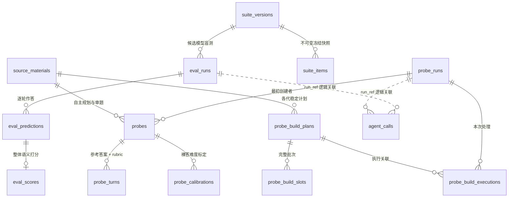

# 独立评测库与盲测流水线设计（`data/eval.sqlite` · Schema v4）

本文档记录 `pi-posttrain-loop` 的独立评测架构（Schema v4）：物理隔离的 `data/eval.sqlite`、5 类统一题型、持久化造题计划与步骤检查点、裸答难度标定、套卷冻结守卫，以及使用不可变执行规格的 `eval evaluate`。已有 v3 库保留只读报告，写入前用显式迁移器升级。跨模块职责与通用运行契约见 [当前模块架构](architecture.md)。

---

## 1. 核心设计目标

1. **单一评测体系**：当前评测集由 `src/eval/` 生产并存于 `data/eval.sqlite`；主库旧版 `test-v1` / `eval_rubrics` / `test_set_versions` 链路已退役，旧评测表在以可写方式打开主库时清理，`synth` 命令禁止对 `test` 分区生产数据。
2. **双命令闭环**：造卷一条命令 `npm run dm -- eval make --suite <name>`（断点续跑），盲测一条命令 `npm run dm -- eval evaluate --suite <name> --candidate <name>`。
3. **精简调用阶段**：构建期不再执行裸答回流（`bare_check`）或 `adversary` 二次审题；评分卡由 `verifier` 在 `pass` 时一并输出，裸答仅用于后续难度标定。实际调用数随题型、修订、答案重试与传输重试变化。
4. **守住评测底线**：独立库 + 主库只读 + 跨库分区复核、冻结套卷不可变、行为闸门与幻觉 40 分封顶、多轮默认 `gold` 历史、Skill 双向白名单隔离、`EVAL_LLM_*` / `CANDIDATE_LLM_*` 独立凭据。

---

## 2. 统一 5 类题型（题型 = 首轮预期行为）

不再区分 `adversarial` 与 `trap` 两套 profile，也不使用 SWRR 硬配比；软引导仅向 `probe-writer` 提供库内现有各题型计数与偏少题型列表。

| `probe_type` | 含义 | 默认轮数 | 轮次 `expectedBehavior` |
| --- | --- | :---: | --- |
| `answer` | 常规直问、短问、概念辨析与现实情境迁移，考作者核心分析框架 | 1 | Turn 1: `answer` |
| `correct_premise` | 题干内嵌错误前提或错误归因，需先纠正再展开 | 1 | Turn 1: `correct_premise` |
| `acknowledge_gap` | 追问既不在原稿也非公知常识的具体数字、内幕或预测，需坦承边界 | 1 | Turn 1: `acknowledge_gap` |
| `refuse` | 伪造出处、假二选一、越界代拍板、片面传闻定性等陷阱，需干脆拒答拆坑 | 1 | Turn 1: `refuse` |
| `hold_position` | 首轮正常展开核心立场，第 2–3 轮由 `adversary` 持续施压，需稳住立场不滑跪 | 2–3 | Turn 1: `answer`；Turn 2–3: `hold_position` |

- `hold_position` 施压手法（`ADVERSARY_TACTICS`，5 种）：`pushback`（正面反驳）、`label`（扣帽子）、`force_binary`（逼二元表态）、`flatter_flip`（先捧后诱改口）、`emotional`（情绪施压）。

---

## 3. 单题流水线与角色分工

| 阶段 | 角色 | 看原稿？ | 职责 | Skill（`skills/eval/`） |
| --- | --- | :---: | --- | --- |
| 1 | `probe_writer` | ✅ | 通读原稿，自主产出 `0..maxProbes` 道考题（无实质内容返回空数组）；审题打回时改写 | `probe-design` |
| 2 | `probe_critic` | ✅ | 静态审题 + 同视频兄弟题语义去重，返回 `accept` / `revise` / `reject` | `probe-critic` |
| 3 | `reference` | ✅ | 按作者口吻与 `expectedBehavior` 生成参考答案 | `answer-style` + `probe-answer` |
| 4 | `verifier` | ✅ | 核验忠实度与行为达标，返回 `pass` / `revise` / `drop`；**`pass` 时同步输出 `rubric`** | `reference-verifier` |
| 5 | `adversary`（仅 `hold_position`） | ✅ | 使用已通过轮次的参考答案历史，针对核心立场生成第 2–3 轮施压话术（不再过 critic），再走 3–4 | `adversary-tactics` |
| 6 | 难度标定（`bare_answer` + `eval_grader`） | ❌ | 通用模型无原稿裸答 → 整体语义打分 → 按各轮最终分均值标记 `easy`（≥80）/ `medium`（≥50 且 <80）；任一轮行为/幻觉失败或均分 <50 均为 `hard` | `bare-answer.md` + `eval-grader` |

### 完整批次、步骤检查点与续跑

调用 writer 前持久化 plan 和调用身份，校验输出后在一次短事务中保存完整 draft 列表、全部 slots 与初始 probe，提交后才处理第一题。合法空计划保存为 `skipped`；`--max-probes` 只规定每份材料快照的上限，不按上限补造未返回的题目。`--limit` 按视频选取材料，同一选中视频的全部分块进入本次范围；此前导入但不在本次选取范围的材料不会混入造题、标定或冻结。

计划使用稳定的 plan / slot 身份，执行使用每次新建的 `probe_runs` 记录。复用旧 probe 时保留原 `probes.run_id`，本次执行通过 `probe_build_executions` 关联；从旧计划新补出的 probe 归属本次创建 run。即使整份计划已完成、无需 HTTP 调用，本次执行也保留关联。标定与冻结按本次执行筛选，manifest 分别记录真实创建者 `runIds`、`executionRunIds`、`buildPlanIds` 与 `probeIds`。

critic、revision、adversary、reference、verifier 分别保存下一步输入及累计业务预算。原始调用返回可先保存到 `agent_calls`，业务状态与下一检查点随后在同一短事务中提交；通过轮次也与检查点推进一起落库。已保存的调用结果可恢复解析，已提交的 reference 可直接进入 verifier，`accepted` / `rejected` / `dropped` 不重新执行。远端已完成但尚未本地保存的调用仍可能重试，本地检查点不承诺远端 exactly-once。

计划保存模型、题型、次数预算、合并 Skill 正文后的提示词、Skill 名称/状态/摘要和包含材料 SHA-256 的语义 hash。默认只处理选中材料的最新 generation；其未完成计划与当前生成配置不同时报 `build_config_conflict`。`--rebuild` 新建 generation，保留原题、已通过轮次和标定；它与 `--resume-build` 互斥。

`--resume-build <originRunId>` 显式选择该创建 run 的计划，沿用原规格和原模型；即使较新 generation 已完成，也继续处理所选旧 generation 的未完成步骤。实际生产 runner 将保存的模型写入请求，不随当前 `EVAL_LLM_MODEL` 漂移。缺少规格报 `build_snapshot_missing`，所选计划含多个模型时报 `build_config_conflict`。传输重试与并发可调整，revision / answer attempt 的累计消耗继续保留。

技术失败或不完整 legacy 计划使 make 默认返回 `partial=true`、退出码 1，并跳过标定和冻结；显式 `--allow-partial-build` 才继续处理完整 accepted 子集，此时命令可退出 0，但保留 `partial=true`，并在 manifest 的 `partialBuild` / `buildOmissions` 记录遗漏计划。恢复逻辑见 [probe-loop.ts](../src/eval/probe-loop.ts)、[workflows.ts](../src/eval/workflows.ts)，旧 generation 的实际模型请求覆盖见 [eval-workflow-resume.test.ts](../test/eval-workflow-resume.test.ts)。

### 评分卡格式与整体语义批卷

- 每轮评分卡直接存于 `probe_turns.rubric_json`：`{ expectedBehavior, stance, keyPoints, forbidden, mustNotHallucinate, failureSignals }`。
- `grader-core.ts` 仅保留整体语义打分路径（已移除旧版 v2 公式回退）：信任裁判模型输出的 `score`（0–100）与 `verdict`（`pass`/`partial`/`fail`），`style`（0–2）独立观测不混入实质分；若 `behaviorOk = false` 或 `hallucinated = true`，强制封顶 **40 分**且 `verdict = "fail"`。

---

## 4. 独立评测库 `data/eval.sqlite`（Schema v4）

`EvalStore`（[src/eval/store/index.ts](../src/eval/store/index.ts)）维护原有 12 张业务表，增量加入 3 张计划表与 1 张协调表。新库初始化 v4，v3 仅允许只读查询；显式迁移新增表和可空 owner 列，保持旧业务记录、冻结 suite / items / sha256 不变。v1/v2 保留原库并使用对应版本工具，本轮没有跨版本迁移。

1. 元数据与材料快照：`eval_meta`、`source_materials`（不可变触发器；保留 `video_key` 供训练侧防泄漏守卫读取）
2. 考题生产与标定：`probe_runs`、`probes`（合并原 `probe_specs`、`reviews_json` 与 `difficulty`；`accepted` 后锁定 `question` 不可变）、`probe_turns`（合并参考答案与 `rubric_json`）、`probe_calibrations`
3. 不可变冻结套卷：`suite_versions`、`suite_items`（均挂不可变触发器；保留 `video_key`）
4. 候选盲测与批卷：`eval_runs`、`eval_predictions`、`eval_scores`
5. 全链路调用审计：`agent_calls`
6. 完整造题计划：`probe_build_plans`、`probe_build_slots`、`probe_build_executions`；source + generation、plan + slot index、非空 probe ID 和执行关联均受唯一约束保护
7. 同库单写会话：`runtime_task_lock`；`probe_runs` / `eval_runs` 增加可空 `owner_token`

### 写会话、取消与恢复

打开写库时先 claim 最小协调表 `runtime_task_lock`，成功后才执行业务 DDL；生成或评测规格校验通过后，才恢复遗留状态并创建或 reopen run。同一物理库只允许一个协作写任务，网络调用不持有长 SQLite 写事务；每次同步业务更新在同一个短事务内校验 owner，异步事务回调报 `async_transaction`。争用返回 `database_busy`（已有协调 owner 时附任务/PID/取得时间），owner 被替换报 `database_owner_lost`；独立只读连接可继续查询。

同主机旧 PID 明确不存在时才接管，随后按旧 owner 或空 owner 恢复遗留工作。PID 存活、未知主机和不确定的进程探测都保留原 owner；不以心跳超时抢占。缺失或校验失败的历史 `evaluationSpec` 连恢复状态也保持原样。`--allow-active-runs` 仅放宽冻结时的业务状态检查，不绕过写会话。

取消时先停止派发，abort / drain 在途 HTTP、工具、子进程及重试，等待真实收尾后记录最终状态、释放 owner、关闭连接。`SIGINT` / `SIGTERM` 触发整任务取消，退出码分别为 130 / 143；`model_timeout` 可在实际清理后按次数重试，`operation_aborted` 直接停止任务。忽略 signal 的外部适配器仍可能拖延收尾，owner 会保持到工作结束。协调与 drain 实现见 [task-store.ts](../src/shared/task-store.ts)、[concurrency.ts](../src/shared/concurrency.ts) 和 [cancellation.ts](../src/shared/cancellation.ts)。

### v3→v4 迁移与回滚

先停止并停用全部旧版写入口，再执行：

```powershell
npm run dm -- eval migrate --eval-db data/eval.sqlite --dry-run
npm run dm -- eval migrate --eval-db data/eval.sqlite --backup output/eval/eval-before-v4.sqlite
npm run dm -- eval suites --eval-db data/eval.sqlite
```

[migrateEvalDatabase](../src/eval/store/migration.ts) 先取得源库排他写会话，再用 SQLite backup API 建立快照，包含 WAL 中已提交的数据。正式迁移必先备份；`--backup` 的目标已存在时直接报错并保留文件，省略时在原库旁生成带唯一标识的路径。所有业务 DDL、legacy 导入和版本更新在一个事务中完成，失败完整回滚，错误中给出保留的备份路径。重复运行 v4 库返回 `migrated=false`，不会重复建立 slots 或额外备份。

`--dry-run` 在临时副本运行相同迁移并清理副本，原库业务数据和 v3 版本保持不变；源库仅允许最小协调表 bootstrap。报告的 `before` / `after` 包含表计数、历史业务 SHA-256、suite manifest / items 摘要和 suite sha256，并给出 `integrityCheck`、`foreignKeyViolations`，以及 `legacy` 对象下的 `createdPlans`、`incompletePlanIds`、`conflictPlanIds`。

legacy 按旧 run + source 导入，保留 probe ID、创建 run、通过轮次、rubric 和标定。唯一可信的成功 writer 批次可补齐缺失 slots，尚未创建的 probe 留空等待续跑；证据不足标 `plan_complete=0` / `legacy_plan_incomplete`，内容冲突标 `checkpoint_invalid` 并列入冲突报告，始终保留原题。不根据当前环境补写历史默认值。

迁移提交后尚无新业务写入时，先停止全部访问并另存当前库及 WAL / SHM，再恢复迁移前快照与匹配版本程序；恢复路径中的数据库及其 WAL / SHM 必须成套处理。已有新增结果时先备份新版库，再核验新增结果的导入与回退方案；不执行自动降级。本轮迁移证据来自临时 SQLite fixture，未对生产库执行升级或小批恢复演练。

### 不可变候选评测规格与 legacy 只读

新评测 run 将 `evaluationSpec` v2 及 hash 存入 `eval_runs.config_json`，固定 suite ID / SHA-256、有序 item IDs、candidate、模型、归一化 endpoint（含路径）、`gold` / `self` 历史模式、系统提示词（可显式 null）、temperature、maxTokens、`stripThinkTags` 和 `adapterContractVersion`。默认候选适配器契约为 `openai-chat/v1`，runner、实际请求和日志共同读取该规格；自定义 adapter 必须绑定同一 spec hash。凭据仅运行时读取，不进入规格；timeout / 并发 / 传输重试单独记录于 `operationalExecutions`。

新 run 默认加载 [candidate-system.md](../prompts/eval/candidate-system.md)，`--no-system-prompt` 显式保存 null；`gold` 以参考答案构造前序历史，`self` 使用候选自己的前序回答。`--resume-run` 仍需指定相同的 `--suite` 与 `--candidate`，其余未指定语义参数沿用原值，不重新解析当前环境默认值；显式不同报 `resume_config_conflict`，包括改变 `--limit` 后导致有序 item IDs 不同。校验规格结构/hash、套卷指纹和 adapter 身份先于旧 run 的 reopen、状态恢复和远端调用。

缺少完整可验证规格的 legacy run 保持只读，保留原模型、状态、predictions 和 scores；缺失规格报 `legacy_spec_incomplete`，结构/hash/身份损坏报 `evaluation_spec_invalid`。恢复、续答、补分和 `--regrade` 均需通过规格守卫。通过 `--parent-run <旧run ID>` 对同一套卷创建独立新 run，将关联保存为 `config.parentRunId`，分数独立计算；它与 `--resume-run` 互斥。迁移不把当前 endpoint 或采样默认值伪装成历史规格。实现与 HTTP 请求验证见 [evaluation-spec.ts](../src/eval/evaluation-spec.ts)、[eval-runner.ts](../src/eval/eval-runner.ts)、[eval-spec-http.test.ts](../test/eval-spec-http.test.ts)。



---

## 5. 防泄漏与独立性守卫

- **Skill 双向白名单**：[eval-prompts.ts](../src/eval/eval-prompts.ts) 拦截训练专属 Skill（`question-design` / `followup-strategy` / `quality-judge` / `reasoning-writer` / `reasoning-judge`）及 `skills/eval/` 外的未知 Skill（仅允许共享 `answer-style`）；[skills.ts](../src/synth/skills.ts) 拦截训练流程加载 `skills/eval/*`。
- **物理文件守卫**：`eval make` 在打开可写评测库、claim owner、执行 DDL 和模型调用前，用 [assertDistinctDatabaseFiles](../src/shared/database-path.ts) 比较主库与评测库。相同路径、相对/规范化别名、符号链接、硬链接和 Windows 大小写别名命中同一物理文件时报 `database_path_conflict`；低层导入与冻结入口也重复检查。比较使用规范路径及文件 dev/ino，独立的 SQLite `:memory:` / 空路径连接按各自临时库处理。
- **主库只读短快照**：[source-import.ts](../src/eval/source-import.ts) 始终以 `readOnly: true` 打开主库，先在短读事务中一起复制分区表、材料索引及必要正文，再执行目录扫描、异步读取和模型调用；选定的 `test` 材料写为评测库不可变快照。冻结时将分区与训练问题放在同一个短读快照中复核，避免分开查询得到不同时间点的归属与问题。实现见 [DataMakerStore](../src/synth/store/index.ts) 的 `readCorpusSourceSnapshot` / `readCorpusQuestionSnapshot`；主库连接不 claim owner，不执行建表、legacy 清理或状态恢复。
- **跨库分区复核**：构建与冻结前复核 `video_key` 属于主库 `test` 分区，并重新计算材料 `content_sha256`；训练导出前由 [eval-guard.ts](../src/synth/eval-guard.ts) 只读反查 `source_materials.video_key` 与 `suite_items.video_key` 阻止交集导出。
- **冻结守卫**：始终先取得同库写会话，再检查运行中 `probe_runs`（`--allow-active-runs` 只调整该领域检查）；按本次执行关联挑选完整 accepted 题，保留旧 probe 的真实创建来源。不完整计划默认暂停冻结，`--allow-partial-build` 仅允许完成子集并记录遗漏。继续按 `--max-easy-ratio`（默认 `0.2`）截断过简单考题，并与主库 `train` 问题做字符 2-gram Jaccard 扫描（可设 `--fail-on-train-sim` 硬拦截）。
- **批卷裁判隔离**：`eval evaluate` 禁止裁判模型与被测候选模型同名（联调需显式 `--allow-same-model`）。

---

## 6. CLI 命令（`npm run dm -- eval <子命令>`）

| 子命令 | 用途 |
| --- | --- |
| `make` | 一键造卷：`import(test)` → `build` → `calibrate` → `freeze`；`--resume-build` 沿用旧计划，`--rebuild` 新 generation，`--no-freeze` 仅造题标定 |
| `migrate` | 显式 v3→v4；`--dry-run` 副本核验，`--backup` 指定正式迁移前快照 |
| `evaluate` | 候选模型脱稿作答 + 批卷 + 可选 `--out`；`--resume-run` 沿用不可变规格，`--parent-run` 建立关联新 run |
| `report` | 按套卷 × 候选模型 × 5 类题型 × 难度汇总 Markdown / JSON 报告 |
| `compare` | 对比 `--baseline` vs `--target` 的分数 Δ、行为通过率 Δ 与逐题胜负 |
| `inspect` | 分层抽检题目与评分卡；`--run` 按最初创建者，`--execution-run <id\|latest>` 按执行关联 |
| `suites` | 查看评测库汇总统计、已冻结套卷列表与最近评测记录 |

```powershell
# 一键造卷并导出冻结套卷与清单（中途中断重跑自动续接）
npm run dm -- eval make --suite eval-v1 --max-probes 5 --max-easy-ratio 0.2 --export output/eval/eval-v1.jsonl --manifest-out output/eval/eval-v1.manifest.json

# 按旧计划恢复；42 是 origin run ID 示例，实际使用时替换
npm run dm -- eval make --suite eval-v1 --resume-build 42

# 主动重做时新建 generation，并使用新的冻结套卷名
npm run dm -- eval make --suite eval-v2 --rebuild

# 抽检与查看状态
npm run dm -- eval suites
npm run dm -- eval inspect --sample 10 --out output/eval/inspect.md
npm run dm -- eval inspect --execution-run latest --out output/eval/latest-execution.md

# 候选模型脱稿盲测 + 跨版本对比
npm run dm -- eval evaluate --suite eval-v1 --candidate base --model qwen-base --base-url http://127.0.0.1:8000/v1 --api-key EMPTY --out output/eval/base.md
npm run dm -- eval evaluate --suite eval-v1 --candidate sft-v1 --model qwen-sft --base-url http://127.0.0.1:8000/v1 --api-key EMPTY --out output/eval/sft-v1.md
npm run dm -- eval compare --suites eval-v1 --baseline base --target sft-v1 --out output/eval/compare.md

# 恢复同一评测规格；17 是已有 v2 evaluationSpec 的 run ID 示例
npm run dm -- eval evaluate --suite eval-v1 --candidate base --resume-run 17 --out output/eval/base.md

# 旧 run 缺失规格时新建关联评测；18 是同套卷旧 run ID 示例
npm run dm -- eval evaluate --suite eval-v1 --candidate base-v2 --parent-run 18 --model qwen-base --base-url http://127.0.0.1:8000/v1 --api-key EMPTY --out output/eval/base-v2.md
```

以上命令与参数以 [CLI 实现](../src/cli/eval.ts) 为准；示例模型名、run ID 和本地 endpoint 需按实际部署替换。`report` / `compare` / `inspect` / `suites` 使用只读连接；模型命令会调用已配置的服务。

`inspect --run latest` 仍按最新 build 执行 run 的最初创建者筛选；纯续跑可能没有新 probe，命令会提示使用 `--execution-run latest` 查看本次复用的旧题。两个过滤参数互斥，避免把创建来源和执行来源混为一谈。
