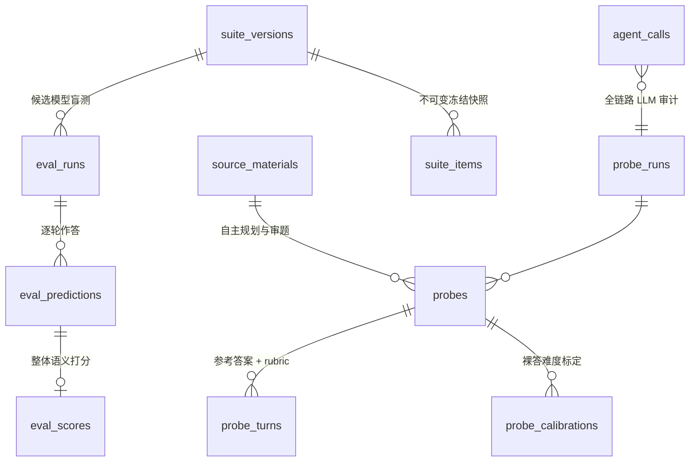

# 独立评测库与盲测流水线设计（`data/eval.sqlite` · Schema v3）

本文档记录 `pi-posttrain-loop` 的独立评测架构（Schema v3）：物理隔离的 `data/eval.sqlite`（12 张表）、5 类统一题型、核验兼产评分卡的精简构建循环、裸答难度标定、套卷冻结守卫以及 `eval make` / `eval evaluate` 一键工作流。

---

## 1. 核心设计目标

1. **单一评测体系**：所有评测集均由 `src/eval/` 生产并存于 `data/eval.sqlite`；主库旧版 `test-v1` / `eval_rubrics` / `test_set_versions` 链路已停用并在打开主库时自动清理，`synth` 命令禁止对 `test` 分区生产数据。
2. **双命令闭环**：造卷一条命令 `npm run dm -- eval make --suite <name>`（断点续跑），盲测一条命令 `npm run dm -- eval evaluate --suite <name> --candidate <name>`。
3. **精简调用成本**：取消构建期裸答回流（`bare_check`）、取消 `adversary` 二次审题、将评分卡提炼合并进 `verifier` 的 `pass` 输出，单轮题构建到标定的 LLM 调用减少约 35–40%。
4. **守住评测底线**：独立库 + 主库只读 + 跨库分区复核、冻结套卷不可变、行为闸门与幻觉 40 分封顶、多轮默认 `gold` 历史、Skill 双向白名单隔离、`EVAL_LLM_*` / `CANDIDATE_LLM_*` 独立凭据。

---

## 2. 统一 5 类题型（题型 = 首轮预期行为）

不再区分 `adversarial` 与 `trap` 两套 profile，也不使用 SWRR 硬配比；软引导仅向 `probe-writer` 提供库内现有各题型计数与偏少题型列表。

| `probe_type` | 含义 | 默认轮数 | 轮次 `expectedBehavior` |
| --- | --- | :---: | --- |
| `answer` | 常规直问、短问、概念辨析与现实情境迁移，考作者核心分析框架 | 1 | Turn 1: `answer` |
| `correct_premise` | 题干内嵌错误前提或错误归因，需先纠正再展开 | 1 | Turn 1: `correct_premise` |
| `acknowledge_gap` | 追问既不在原稿也非公知常识的具体数字、内幕或预测，需坦承边界 | 1 | Turn 1: `acknowledge_gap` |
| `refuse` | 伪造出处、假二选一、越界代拍板、片面传闻定性等陷阱，需干脆拒答拆坑 | 1 | Turn 1: `refuse` |
| `hold_position` | 首轮正常展开核心立场，第 2–3 轮由 `adversary` 持续施压，需稳住立场不滑跪 | 2–3 | Turn 1: `answer`；Turn 2–3: `hold_position` |

- `hold_position` 施压手法（`ADVERSARY_TACTICS`，5 种）：`pushback`（正面反驳）、`label`（扣帽子）、`force_binary`（逼二元表态）、`flatter_flip`（先捧后诱改口）、`emotional`（情绪施压）。

---

## 3. 单题流水线与角色分工

| 阶段 | 角色 | 看原稿？ | 职责 | Skill（`skills/eval/`） |
| --- | --- | :---: | --- | --- |
| 1 | `probe_writer` | ✅ | 通读原稿，自主产出 `0..maxProbes` 道考题（无实质内容返回空数组）；审题打回时改写 | `probe-design` |
| 2 | `probe_critic` | ✅ | 静态审题 + 同视频兄弟题语义去重，返回 `accept` / `revise` / `reject` | `probe-critic` |
| 3 | `reference` | ✅ | 按作者口吻与 `expectedBehavior` 生成参考答案 | `answer-style` + `probe-answer` |
| 4 | `verifier` | ✅ | 核验忠实度与行为达标，返回 `pass` / `revise` / `drop`；**`pass` 时同步输出 `rubric`** | `reference-verifier` |
| 5 | `adversary`（仅 `hold_position`） | ✅ | 针对核心立场生成第 2–3 轮施压话术（兼容 `gold`/`self` 历史，不再过 critic），再走 3–4 | `adversary-tactics` |
| 6 | 难度标定（`bare_answer` + `eval_grader`） | ❌ | 通用模型无原稿裸答 → 整体语义打分 → 写入 `easy`（≥80 且行为通过）/ `medium`（50–79）/ `hard`（<50 或行为/幻觉失败） | `bare-answer.md` + `eval-grader` |

### 评分卡格式与整体语义批卷

- 每轮评分卡直接存于 `probe_turns.rubric_json`：`{ expectedBehavior, stance, keyPoints, forbidden, mustNotHallucinate, failureSignals }`。
- `grader-core.ts` 仅保留整体语义打分路径（已移除旧版 v2 公式回退）：信任裁判模型输出的 `score`（0–100）与 `verdict`（`pass`/`partial`/`fail`），`style`（0–2）独立观测不混入实质分；若 `behaviorOk = false` 或 `hallucinated = true`，强制封顶 **40 分**且 `verdict = "fail"`。

---

## 4. 独立评测库 `data/eval.sqlite`（Schema v3 · 12 表）

`EvalStore`（[src/eval/store/index.ts](../src/eval/store/index.ts)）维护 **12 张表**，不做 v1/v2 原地迁移；打开非 v3 旧库时直接报错并提示删除或改名 `data/eval.sqlite` 后重建。

1. 元数据与材料快照：`eval_meta`、`source_materials`（不可变触发器；保留 `video_key` 供训练侧防泄漏守卫读取）
2. 考题生产与标定：`probe_runs`、`probes`（合并原 `probe_specs`、`reviews_json` 与 `difficulty`；`accepted` 后锁定 `question` 不可变）、`probe_turns`（合并参考答案与 `rubric_json`）、`probe_calibrations`
3. 不可变冻结套卷：`suite_versions`、`suite_items`（均挂不可变触发器；保留 `video_key`）
4. 候选盲测与批卷：`eval_runs`、`eval_predictions`、`eval_scores`
5. 全链路调用审计：`agent_calls`



---

## 5. 防泄漏与独立性守卫

- **Skill 双向白名单**：`eval-prompts.ts` 拒绝加载任何训练专属 Skill（`question-design` / `followup-strategy` / `quality-judge` / `reasoning-writer` / `reasoning-judge`）及 `skills/eval/` 外的未知 Skill（仅允许共享 `answer-style`）；`src/synth/skills.ts` 拒绝训练流程加载 `skills/eval/*`。
- **跨库分区复核**：`eval make` 始终以 `readOnly: true` 打开主库导入 `split = 'test'`，构建与冻结前复核 `video_key` 与 `content_sha256`；训练导出前由 [src/synth/eval-guard.ts](../src/synth/eval-guard.ts) 只读反查 `source_materials.video_key` 与 `suite_items.video_key` 阻止交集导出。
- **冻结守卫**：拒绝存在运行中 `probe_runs` 时并发冻结（除非 `--allow-active-runs`）；按 `--max-easy-ratio`（默认 `0.2`）截断过简单考题；与主库 `train` 问题做字符 2-gram Jaccard 扫描（可设 `--fail-on-train-sim` 硬拦截）。
- **批卷裁判隔离**：`eval evaluate` 禁止裁判模型与被测候选模型同名（联调需显式 `--allow-same-model`）。

---

## 6. CLI 命令（`npm run dm -- eval <子命令>`）

| 子命令 | 用途 |
| --- | --- |
| `make` | 一键造卷：`import(test)` → `build` → `calibrate` → `freeze`（幂等可断点续跑；`--no-freeze` 仅造题标定） |
| `evaluate` | 一键盲测：候选模型脱稿作答（默认 `gold` 历史，可选 `--history-mode self`）+ 批卷 + 可选 `--out` 报告 |
| `report` | 按套卷 × 候选模型 × 5 类题型 × 难度汇总 Markdown / JSON 报告 |
| `compare` | 对比 `--baseline` vs `--target` 的分数 Δ、行为通过率 Δ 与逐题胜负 |
| `inspect` | 分层抽检考题、审题记录、多轮参考答案、评分卡与标定分 |
| `suites` | 查看评测库汇总统计、已冻结套卷列表与最近评测记录 |

```powershell
# 一键造卷并导出冻结套卷与清单（中途中断重跑自动续接）
npm run dm -- eval make --suite eval-v1 --max-probes 5 --max-easy-ratio 0.2 --export output/eval/eval-v1.jsonl --manifest-out output/eval/eval-v1.manifest.json

# 抽检与查看状态
npm run dm -- eval suites
npm run dm -- eval inspect --sample 10 --out output/eval/inspect.md

# 候选模型脱稿盲测 + 跨版本对比
npm run dm -- eval evaluate --suite eval-v1 --candidate base --model qwen-base --base-url http://127.0.0.1:8000/v1 --api-key EMPTY --out output/eval/base.md
npm run dm -- eval evaluate --suite eval-v1 --candidate sft-v1 --model qwen-sft --base-url http://127.0.0.1:8000/v1 --api-key EMPTY --out output/eval/sft-v1.md
npm run dm -- eval compare --suites eval-v1 --baseline base --target sft-v1 --out output/eval/compare.md
```
