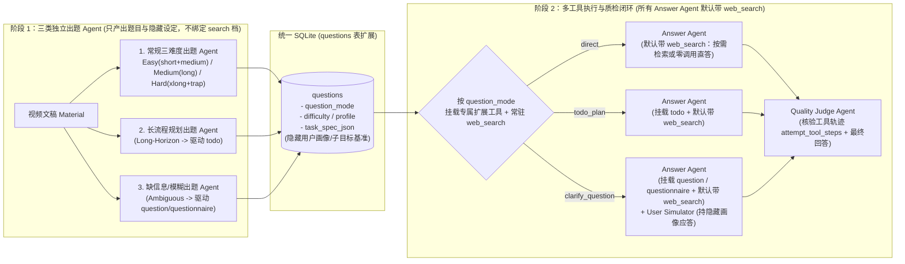

# Pi 全工具后训练数据集制作草案（出题解耦与扩展工具训练架构）

创建日期：2026-11-28  
参考基线：[pi-tool-schemas.md](research/pi-tool-schemas.md) · [production-workflow.md](production-workflow.md) · [0002-isolated-pi-agents-per-role.md](adr/0002-isolated-pi-agents-per-role.md)

> 状态校准（2026-11-28）：本文保留原始工具训练规划。问题范式与隐藏设定、todo / clarify profile、用户模拟器、共享澄清预算、持久工具审计及取消收尾已经实现；当前职责与默认值见[架构说明](architecture.md)。后文的“现有痛点”、目标配比和阶段清单按立项时口径阅读，不能据此判断当前代码缺少这些能力；系统工具回放、开源轨迹重映射等扩展仍按规划管理。
>
> Pi 1.7.0 是外部 Schema 研究基线；本项目安装的 Pi SDK 为 1.6.0。检索并非无条件全员挂载：standard 默认关闭，其他 profile 的常规默认及显式 runner / no-skill 例外由当前计划解析器决定。

---

## 一、总体规划：系统级工具与内容/认知级工具解耦 + `web_search` 全域底座化

基于 `earendil-works/pi` v1.7.0 的三层工具架构，训练数据按**是否依赖领域语料与人格立场**拆为两条正交流水线，并将 **`web_search` 升级为所有 Answer Agent 默认挂载的底层通用能力**（同时配合少量专项事实核查集）：

| 工具类别 | 包含的 Pi Tools | 与本库语料关系 | 制作策略 |
| :--- | :--- | :--- | :--- |
| **A. 系统与环境交互工具**（内容无关） | 1. **核心文件/Shell**：`read`, `bash`, `powershell`, `edit`（`edits[]`）, `write`, `grep`, `find`, `ls` 2. **元工具与 MCP 协议**：`tool_search`, `codemode`, `list_mcp_resources`, `list_mcp_resource_templates`, `read_mcp_resource` | **无关**（纯工程规范、Schema 契约与多步系统操作） | **独立轨迹合成 + 开源高质数据重映射（Remap）**，作为 10%–20% 通用工具回放数据混入，防止微调后丧失 Coding/Agent 基础能力 |
| **B. 认知规划与交互扩展工具**（内容强耦合） | `todo`, `question`, `questionnaire`（含可选 `subagent` / `structured_output`） | **强耦合**（何时拆解长任务、何时因信息缺失向用户追问，直接体现作者的分析框架与边界定力） | **深度改造本项目的 `synth` + `cot` 流水线**：将出题 Agent 与下游执行解耦，按认知复杂度分设 **3 类独立出题 Agent** 驱动 |
| **C. 全域基础检索工具**（默认常驻 + 独立专项补充） | `web_search`（导出时支持多 Schema 泛化：`web_search / search_web / internet_search / query_search`） | **半耦合**（认知题按需自然触发检索；纯客观事实/多跳核查可独立构造） | **双轨制**： 1. **全员默认挂载**：三类认知题的 Answer Agent **全部默认携带 `web_search`**，让模型在复杂问题中学会“按需自然检索，无需检索时绝不瞎调”； 2. **独立小规模专项集**：保留/独立制作一套“强事实/时效/外部数据核查”专项集（或融合开源多跳搜索轨迹并统一改写为作者口吻），专门强化搜商（Query 构造与去伪存真） |

---

## 二、核心改造：出题 Agent 与下游问答流水线解耦

### 2.1 立项时的耦合痛点（历史背景）

立项时 `synth run`（`src/synth/workflows.ts`）把“出题 + 作答 + 质检 + 追问”绑在同一个 `profile`（`short / medium / long / xlong / trap / search`）单通道里：
1. **搜索被当成一个孤立的“题型档位”**：过去把 `search` 和 `short / long` 并列，导致出题方向容易偏向“为了调搜索而专门考一个外部冷知识/工程查表题”，稀释了三档常规题本身的**思想深度与分析难度**；同时其他复杂档位（`long / xlong / todo`）反而没挂搜索工具。
2. **`questions` 表缺乏求解范式与隐藏上下文契约**：`questions` 表只存纯字符串 `question` 和 `generation_run_id`，没有显式记录这道题的“求解范式（Task Paradigm）”与“预设隐藏上下文（如模糊题背后的真实用户处境）”。

### 2.2 解耦后的两阶段架构（所有 Answer Agent 默认常驻 `web_search`）

将 **阶段 1（出题入库 `synth questions`）** 与 **阶段 2（带工具执行与质检 `synth judge`）** 通过数据库的**任务契约字段**彻底解耦，且下游所有 Answer Agent 默认挂载 `web_search`：

### 2.3 `questions` 表最小扩展设计

在 `questions` 表新增两个轻量元数据列（向后兼容现有全部题目）：
- `question_mode TEXT NOT NULL DEFAULT 'direct'`：枚举 `'direct'`（常规三难度）、`'todo_plan'`（长流程规划）、`'clarify_question'`（缺信息反问澄清）；
- `task_spec_json TEXT`（可空 JSON）：
  - 对 `'direct'`：存 `{ "difficulty": "easy|medium|hard", "profile": "short|medium|long|xlong|trap" }`；
  - 对 `'todo_plan'`：存出题 Agent 预埋的**必经逻辑阶段参考** `{ "expected_phases": ["...", "..."] }`（仅传给 Judge 核验模型是否乱拆 `todo`，**绝不传给 Answer Agent**）；
  - 对 `'clarify_question'`：存**隐藏用户真实处境与缺失槽位** `{ "missing_slots": ["具体行业/预算/家庭约束"], "hidden_user_persona": "用户真实情况是……当模型调用 question 工具询问时，以此作为选择依据" }`（仅传给扮演用户的 Simulator Tool，**Answer Agent 不可见**）。

---

## 三、三类独立出题 Agent 与配套工具闭环设计

### 1. 第一类：常规三难度出题 Agent（纯粹按认知深度分级，不再混入 `search` 档）

- **定位**：专注于问题的**思想复杂度、机制纵深与边界对抗性**，面向“题干信息自洽、无需反问用户、也无需跨阶段状态机拆解”的题目。
- **三档认知难度纯粹划分**：
  1. **Easy（基础档：`short` + `medium`）**：单概念辨析、单一现象直断、短平快问快答。
     - *工具行为预期*：虽然 Answer Agent 默认挂载了 `web_search`，但在 Easy 档中 **90%+ 应当零工具调用直答**，天然形成高比例的**“携带 `tools` 声明但不盲目调工具”的克制力训练样本（内生负样本）**。
  2. **Medium（进阶档：`long`）**：双概念交叉对比、现实复杂案例的深层机制拆解、完整的逻辑链条推演。
     - *工具行为预期*：当案例涉及外部具体行业背景、历史事件或现行政策细节时，Answer Agent **可自主决定调用 1–2 次 `web_search`** 补齐事实锚点；若纯属原稿内部逻辑推演则直接作答。
  3. **Hard（高难/对抗档：`xlong` + `trap`）**：多 P 跨章节体系贯通（`xlong`），或隐蔽错误前提拆穿、假二选一破局、概念偷换纠偏、越界代拍板拒答（`trap`）。
     - *工具行为预期*：在跨章节综合推演或拆穿事实性伪前提时，模型可自主调用 `web_search` 查证打脸或补充论据，重点考核复杂推理定力与主权边界。

---

### 2. 第二类：长流程规划出题 Agent（专训 `todo` 工具 + 常驻 `web_search`）

#### （1）为什么很多模型训不好 `todo`？
如果给一道普通问题（如“怎么看内卷？”）强行塞 `todo(add)` → `todo(toggle)`，模型学到的是**机械刷工具的形式主义**。只有当题目本身包含**多维度约束、多阶段递进或跨分 P 综合诊断**，不先列清单就会漏项或逻辑塌陷时，调用 `todo` 才有真实的认知收益。

#### （2）出题 Agent（`todo-question-design`）构题规范
专门从**中长文稿或多 P 系列课（Tier 2，`>= 6KB`）**中挖掘需要 **3–5 个严格递进步骤**才能完整解决的复合任务：
- **题型 A：多维处境综合诊断与行动方案**（如提问者同时面临行业收缩、家庭负债、技能转型三个互相牵制的约束，要求先挨个拆清账面风险、排定止损优先级、再给出分阶段过渡方案）；
- **题型 B：跨分 P 理论演进与正反案例全链路推演**（要求把原稿中层层递进的 3–4 个核心命题挨个跑通并回答现实落点）；
- **题型 C：复合对比与多维事实验证任务**（由于 Answer Agent 默认自带 `web_search`，当某个子阶段需要外部数据或法规佐证时，模型在推进该条 `todo` 的过程中会**自然穿插调用 `web_search`**，查完后再 `todo(toggle)` 进入下一阶段）。

#### （3）Answer Agent 执行轨迹与 Pi `todo` Schema 对齐
直接采用 Pi 官方 `examples/extensions/todo.ts` 的精确 Schema（`action: "list" | "add" | "toggle" | "clear"`, `text?`, `id?`），在内存维护一个确定性的 `TodoSandbox` 实例：
1. **起手建单**：Answer Agent 收到复杂题干后，在首轮思考（`preCallThought`）中识别出 3–4 个子任务，连续调用 `todo({ action: "add", text: "..." })` 建立清单（返回 `#1 [ ] ...`）；
2. **推进与钩选（可自然穿插 `web_search`）**：每完成一个关键子阶段（或在某个子阶段内部调用 `web_search` 完成外部核实后），调用 `todo({ action: "toggle", id: 1 })` 标记完成，必要时 `todo({ action: "list" })` 检视剩余项；
3. **收束输出**：全部关键项钩选完成后，输出结构严密、不漏项、且完全符合原稿口语语法的最终长回答（正文中**严禁出现“我已经完成了 Todo 清单第 1 项”**这种破次元报幕腔，`todo` 仅作为模型内部的思维脚手架）。

#### （4）Judge 质检红线（`todo-quality-judge`）
- **查虚晃一枪**：如果只 `add` 不 `toggle`，或者一次性把 4 个 `add` 和 4 个 `toggle` 在同一轮无脑刷完却没有任何中间推演/检索思考，判 `revise`；
- **查拆分粒度**：`todo` 项必须是实质性的分析子目标（3–5 项为宜），不能是“1. 理解问题 2. 思考答案 3. 输出总结”这种废话模板；
- **查正文对齐与零报幕**：最终回答必须真正覆盖 `todo` 清单中的每一项，且正文保持纯粹的第一人称作者口吻。

---

### 3. 第三类：缺信息/模糊题出题 Agent（专训 `question` / `questionnaire` 工具 + 常驻 `web_search`）

#### （1）核心设计思想：把“乱猜硬答”扭转为“精准追问（Clarification）”
现实中用户提问往往丢三落四（隐藏了关键边界条件）。未经训练的模型要么硬猜一个假设长篇大论，要么干巴巴反问一句“你能多说点吗？”。  
Pi 提供了两个专门的结构化反问工具：
- **`question`**：单焦点追问（`{ question, options: [{ label, description? }] }`）；
- **`questionnaire`**：多维度结构化追问（`{ questions: [{ id, label?, prompt, options: [{ value, label, description? }], allowOther? }] }`）。

#### （2）出题 Agent（`clarify-question-design`）的“双面出题法”
出题 Agent 阅读原稿后，**故意剥离 1–3 个决定判断走向的关键约束条件**，同时生成两部分内容存入 `questions` 表：
1. **表面模糊题干（`question`）**：自然简短、看似能答但实际上**差之毫厘谬以千里**的提问（例如原稿明确区分了“体制内稳态岗位”与“高波动私企外包”的完全相反策略，题干故意只问“我现在手头有点积蓄，该拿去进修考证还是先苟着攒钱？”）；
2. **隐藏用户画像（`task_spec_json.hidden_user_persona`）**：把被剥离的真实条件写进隐藏设定（如：`{"真实处境": "二线城市私企外包程序员，31岁，存款仅够半年开支，所考证书非行业硬门槛", "缺失维度": ["岗位性质与稳定性", "现金流安全垫厚度"]}`）。

#### （3）Answer Agent 执行与“用户模拟器（User Simulator）”闭环
无需把 `dialogue-loop` 改成复杂的多轮人工交互，**直接把 User Simulator 封装在 `question` / `questionnaire` 工具的 `execute()` 回调内部**：
1. Answer Agent 收到模糊题干，识别出缺失的关键分支条件：
   - 若只缺 **1 个**核心分水岭变量 → 调用 Pi `question` 工具，给出精准直白的问题与 2–4 个互斥的典型处境选项（`options`）；
   - 若同时缺 **2–3 个**正交维度（如既不知道对方行业属性，也不知道现金流冗余和核心诉求）→ 调用 Pi `questionnaire` 工具，一次性拉出 2–3 个 Tab 问题；
2. **`question` / `questionnaire` 工具内部自动触发 User Simulator**：
   - 工具的 `execute()` 读取 `task_spec_json.hidden_user_persona`（轻量调一次低成本 `followup` 角色，或基于规则匹配最契合的 option），模拟真实用户点选了对应选项（或通过 `allowOther` 补充一句简短大白话），按 Pi 官方返回格式原样返回：
     - `question` 返回：`User selected: <label>`；
     - `questionnaire` 返回：`{"answers": [{"id": "...", "value": "...", "label": "..."}]}`；
3. Answer Agent 拿到用户的明确选择后（如果用户选择的具体处境涉及某个具体外部政策/行业数据，还可按需顺手调一次 `web_search`），**一锤定音**，直接针对该具体处境输出精准、犀利、绝不骑墙的作者口吻回答！

#### （4）Judge 质检红线（`clarify-quality-judge`）
- **严拦“不问硬猜”与“八面玲珑骑墙答”**：在 `clarify` 档中，若 Answer Agent 没调 `question`/`questionnaire` 就直接分“情况一、情况二、情况三”写万能片汤话，必判 `revise`；
- **严查选项质量（Options Design）**：调用 `question`/`questionnaire` 时，给用户列的 `options` 必须是**真正决定作者判断走向的分水岭选项**（源自 `material` 的核心分类轴），严禁列无关痛痒的凑数选项；
- **严查过度追问**：最多允许调用 **1 次** `question` 或 `questionnaire`（拿到核心缺失信息后必须立刻作答，严禁连环查户口式追问）。

---

## 四、`web_search` 搜索工具的双轨定位：全员常驻 + 独立专项集怎么样？

把 `search` 从“常规三难度出题”中剥离出来、改为**“全员默认挂载 `web_search` + 独立搜索专项集”**，是一个**显著优于原方案**的设计。具体利弊与配套措施如下：

### 4.1 为什么“所有 Answer Agent 默认自带 `web_search`”更好？

1. **彻底消除“出题偏向工程查表”的扭曲**：
   - 三难度出题 Agent 不再需要“为了凑一个 `search` 档而去抠外部细节”，可以 100% 聚焦在概念辨析（Easy）、机制纵深（Medium）和跨篇贯通/陷阱对抗（Hard）上。
2. **自然涌现“何时该搜、何时不该搜”的决策边界（无需人工硬凑负样本）**：
   - 过去因为只有 `search` 档挂了工具，导出时不得不靠 `--negative-tools-ratio` 随机给非 search 样本硬塞一个假的 `tools` 声明；
   - 现在所有 Answer Agent 在合成时**原生就挂着 `web_search`**：
     - 遇到纯逻辑/概念题（如大部分 Easy 和部分 Medium/Hard），模型直接作答（0 次搜索调用）→ **天然成为最真实的“带工具不乱调”负样本**；
     - 遇到需要现实数据、政策法条、事件背景支撑的复杂题（部分 Medium/Hard/`todo`/`clarify`），模型自主触发 1–2 次 `web_search` → **工具调用与深度思考无缝融合**。
3. **防止“搜商退化”的唯一护栏（System Prompt 约束）**：
   - 全员挂 `web_search` 唯一需要注意的是：**防止 Answer Agent 偷懒，把原稿里明明有现成深刻框架的概念也拿去搜百度百科**。
   - **解决办法**：在所有 Answer Agent 的通用 `answer-style` 或工具指南中写明一条铁律：
     > **`web_search` 触发准则**：仅当问题涉及**原稿未直接给出的外部客观事实、现行法规条文、具体统计数据、真实历史/时事案例背景**时才调用 `web_search`。对于核心概念定义、分类框架、价值判断与破局方法论，必须以你的底层思想体系（参考材料）为唯一主心骨，**严禁为了搜而搜，严禁用互联网通识百科稀释你的核心判断**。

### 4.2 独立做一套 `web_search` 集 vs 直接用开源数据集？

除了上面“在三类出题中自然触发搜索”之外，我们是否还需要单独的搜索训练集？建议采用**“项目内现有 `search` 独立小专项 + 开源多跳搜索重映射”结合**：

| 方案维度 | 方案 1：直接用开源搜索数据集（如 Mind2Web / Search-R1 / WebGLM / ToolACE 搜索子集） | 方案 2：用本项目现有 `search` 管线独立做一套小规模“硬核考证集”（300–500 条） |
| :--- | :--- | :--- |
| **优势** | 零 API 成本，包含丰富的多跳 Query 改写、关键词提炼与跨网页信息拼图轨迹 | **回答口吻与作者人格 100% 一致**；结合了 Exa + Tavily 双引擎真实检索返回，不会教出“翻译腔/客服腔总结机器” |
| **劣势 / 风险** | **文风严重污染风险**：开源搜索数据集的最终回答几乎全是维基百科式的客观中立腔或 AI 客服报幕腔（“根据搜索结果，我们可以得知……”），直接混入太多会冲淡作者辛辣、笃定的口语人设 | 消耗 Exa/Tavily 额度与合成 Token |
| **最佳组合建议** | **不直接裸用开源搜索数据的最终回答**；仅抽取开源集中的“多跳 Query 改写与失败重搜”模式作为系统级工具回放（占比 `< 5%`） | **保留现有 `--profile search` 作为独立于三难度的“事实核查/时事考证专项通道”**（约占总量的 `10%–15%`）：专门挑需要查具体法条、宏观数据、引文出处的题，训练高难度的多轮精准检索 + 作者口吻落锤 |

---

## 五、系统交互类工具（第一部分）的获取与独立合成建议

对于 `read / bash / edit / write / grep / find / ls` 以及 `tool_search / codemode / list_mcp_resources / read_mcp_resource` 这类**与视频文稿内容无关**的系统工具：

### 5.1 现成开源数据集可复用与重映射（Remap）清单

目前社区已经有成熟的多步 Tool-Use / Coding Agent 轨迹数据集，**但没有任何现成公开数据集原生使用 Pi v1.7.0 特有的 `edit(edits[])`、`tool_search` 和 `codemode` Schema**。最高效的做法是**“开源轨迹底座 + Schema AST 重映射（Remapping） + 少量针对性合成”**：

1. **文件与 Shell 工具（`read / bash / edit / write / grep / find / ls`）**：
   - **可直接复用的开源底座**：
     - **SWE-bench / SWE-smith / SWE-Gym 轨迹集**（如 `SWE-bench/SWE-smith-trajectories`、`nebius/SWE-agent-trajectories`）：包含大量真实的看代码、搜代码、改文件、跑 bash 测试轨迹；
     - **Glaive / Hermes / xLAM / ToolACE / APIGen-MT**：多轮函数调用与参数抽取基础集（适合提取 `mcp__<server>__<tool>` 风格的外部工具调用）。
   - **确定性 Schema 重映射脚本（无需重跑大模型）**：
     - 将开源轨迹中的 `str_replace_editor` / `apply_diff` / 旧版 `edit(path, old_str, new_str)` 自动转换为 Pi 的 `edit({ path, edits: [{ oldText, newText }] })`（同文件连续多次 edit 自动合并为一个 `edits[]` 数组，天然造出高质量批量 edit 样本！）；
     - 将 `view_file` / `cat` 映射为 Pi 的 `read({ path, offset, limit })`；
     - 将 `ripgrep` / `search_dir` 按比例拆分为两套 Loadout：一半保留在 `bash` 中执行 `rg`/`fd`（对应 Pi 默认 4 工具模式），一半映射为 Pi 的 `grep` / `find` / `ls` 专用工具调用。

2. **Pi 1.7 独有元工具（`tool_search` / `codemode` / `*_mcp_resource*`）——建议用本项目写一个轻量沙盒生成器单独合成 500–1,500 条**：
   - 这 5 个工具逻辑极其确定，**不需要任何视频文稿**，只需构造一批 Mock MCP Servers（如 GitHub、SQLite、Jira、Calendar、文件系统等 30+ 个工具 Schema）：
     - **`tool_search` 两阶段轨迹**：系统只暴露 `tool_search`，给定用户任务 → 模型第 1 步调 `tool_search({ query })`（复用 Pi 源码自带的 `Bm25Ranker` 算出真实返回文本 `Loaded N tools...`）→ 第 2 步上下文动态注入匹配出的 `mcp__<server>__<tool>` Schema → 模型精确调用该 MCP 工具；
     - **`codemode` 编排轨迹**：给定需要批量查询/循环过滤的任务（如“查出所有未关闭且带 bug 标签的 issue 并统计负责人分布”）→ 模型调用 `codemode({ code: "async () => { ... }" })` 在 QuickJS 沙盒里一次性调多个 `tools.*` 并 `return` 汇总对象；
     - **`list_mcp_resources` / `read_mcp_resource` 轨迹**：先 `list_mcp_resources({})` 拿到 URI 列表 → 再 `read_mcp_resource({ server, uri })` 读取内容作答。

---

## 六、脱稿 CoT 补写（`cot backfill`）与导出层对新工具的适配

现有的 `src/reasoning/` 与 `attempt_tool_steps` 表结构非常干净，只需做三处小幅扩展即可无缝支持全员 `web_search` 以及 `todo`、`question`、`questionnaire`：

1. **工具 Schema 注册表扩展（`src/shared/tool-schema.ts`）**：
   - 从单一的 `WebSearchToolVariant` 升级为通用 `PiToolRegistry`，完整收录 Pi 官方的 `todo`、`question`、`questionnaire`、`web_search`（以及独立管道导出的 `read/bash/edit/write/grep/find/ls/tool_search/codemode/mcp_resources`）标准 JSON Schema；
   - **默认常驻 `web_search` 声明导出**：导出 JSONL 时，所有认知问答样本的顶层 `tools: [...]` 数组**默认包含泛化后的 `web_search` 工具定义**，并根据该样本所属的 `question_mode` 叠加注入 `todo` 或 `question` / `questionnaire` 定义（即使某条 Easy 样本完全没调工具，顶层也带着 `tools` 声明，彻底替代原先人工拍脑袋的 `negativeToolsRatio`）。
2. **工具调用前思考（`preCallThought`）补写**：
   - 在 `cot backfill` 中，除了为最终 `assistant` 回答补写 `<think>`，对包含 `todo` / `question` / `questionnaire` / `web_search` 的样本，校验或补写其 `attempt_tool_steps.pre_call_thought`：
     - 调用 `todo(add)` 前的思考：为什么要拆成这几个子目标；
     - 调用 `question` / `questionnaire` 前的思考：发现题干缺了哪个致命边界条件，为什么不能直接硬猜，需要列哪几个互斥选项向用户确认；
     - 调用 `web_search` 前的思考：当前推演到了哪一步，需要核实哪个具体外部事实/数据，为什么原稿内部信息不够需要外部检索佐证。

---

## 七、分步落地路线图（建议迭代顺序）

1. **第一步（全员默认挂载 `web_search` + 常规三难度归并）**：
   - 将常规出题明确归并为 **Easy（`short`+`medium`）/ Medium（`long`）/ Hard（`xlong`+`trap`）** 三档；
   - 在 `dialogue-loop.ts` 中支持为所有 Answer Agent 默认挂载 `web_search`（可通过开关或配置控制，并加入“按需检索、严禁为搜而搜”的提示词约束），保留 `--profile search` 作为可选的独立硬核事实考证集。
2. **第二步（最小闭环验证 `question` / `questionnaire` 与 `todo`）**：
   - 在 `src/shared/types.ts` 与 `src/synth/presets.ts` 新增两个预设：`train-todo`（`--profile todo`）和 `train-clarify`（`--profile clarify`），同样默认挂载 `web_search`；
   - 在 `skills/todo/*` 和 `skills/clarify/*` 编写对应的 `question-design`、`answer-style`、`quality-judge` Skill；
   - 实现内存态的 `createTodoAgentTool()` 与带轻量 User Simulator 的 `createQuestionAgentTool()` / `createQuestionnaireAgentTool()`，接入 `dialogue-loop.ts` 的 `attempt_tool_steps` 落库。
3. **第三步（出题 Schema 升级为支持隐藏画像 `task_spec_json`）**：
   - 让 `clarify` 出题 Agent 在调用 `save_questions` 时支持传入 `{ question, hidden_user_persona, missing_slots }`，驱动 User Simulator 稳定给出高拟真回答。
4. **第四步（独立系统工具集 `pi-sys-tools` 合成与混合导出）**：
   - 编写开源 Coding 轨迹 → Pi `read/bash/edit(edits[])/write` 的转换脚本，以及基于 `Bm25Ranker` 的 `tool_search` / `codemode` 沙盒轨迹合成器，最终在 `synth export` / `cot export` 时按比例与主库数据混合导出。
