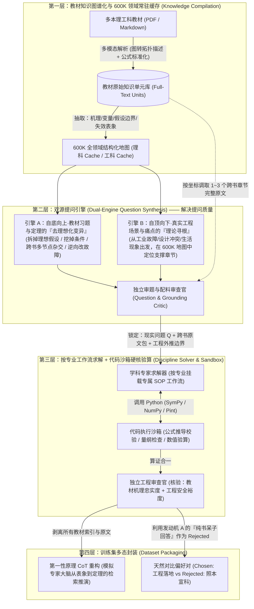

# 理工科教材现实答疑训练集合成方案（独立全新架构 · Draft v0.2）

> **状态**：暂定设计方案（脱离既有项目约束，完全围绕“理工科教材 $\rightarrow$ 现实问题解决能力”从零设计）
> **核心命题**：如何利用大模型（如支持 1M 上下文与 Prefix Caching 的 `v4.1-flash`）和手头的理工科教材，合成一套既具备**严密理科第一性原理推导**、又具备**现实工科落地约束与排障能力**的高质量训练集？

---

## 1. 为什么传统“看教材出题（Chunk-to-QA）”在理工科彻底失效？

原项目针对的是“人文社科/作者观点还原”（看一段文稿 $\rightarrow$ 问一个观点 $\rightarrow$ 还原作者口吻），但理工科现实答疑的底层逻辑完全不同。如果沿用传统的“切块 $\rightarrow$ 出题 $\rightarrow$ 作答”模式，会撞上四堵墙：

1. **知识拓扑结构不同（网状耦合 vs 线性文本）**：
   - 教材是按学科逻辑**解耦**编写的（第 2 章讲导热、第 5 章讲对流、另一本书讲材料强度）；而现实问题天然是**多物理场、多章节强耦合**的（例如“电池包快充发热导致外壳膨胀密封失效”同时横跨电化学、传热学与材料力学）。只看单一切片根本出不出真问题。
2. **因果方向相反（正向推导 vs 逆向工程）**：
   - 教材是 `给定完备条件 + 理想假设 -> 正向算唯一结果`；现实答疑是 `给定异常表象 / 模糊痛点 / 相互冲突的工程指标 -> 逆向定位机理 + 补齐缺失边界 + 给出折中方案`。
3. **“一句话定生死”的容错率差异（精确计算 vs 语义通顺）**：
   - 文科问答差几个词不影响大意；理工科问答只要**一个正负号写反、一个单位制（$\text{mm}$ 与 $\text{m}$）没换算、或者漏掉公式的适用雷诺数范围**，整条训练数据就是“剧毒幻觉”。纯靠 LLM 评委（LLM-as-a-Judge）做文本盲审，极难抓出计算和量纲错误。
4. **理想世界与现实工程的鸿沟（理想模型 vs 寄生参数/安全裕度）**：
   - 教材里导线没有电阻、梁是理想刚体、流体不可压缩；现实工程里到处是寄生电感、接触热阻、加工公差、温漂和成本限制。

---

## 2. 全新架构全景：600K 领域记忆常驻 + 双引擎驱动（正向演化 & 逆向映射） + 代码沙箱验算

既然手握长上下文（`v4.1-flash`）且 Prefix Cache 成本极低，我们可以**彻底抛弃死板的单切片循环**，将架构建立在 **“600K 全领域知识地图常驻内存”** 之上，采用 **“双源提问引擎 + 混合检索路由 + Python 沙箱符号/数值验算 + 认知内化思考链”** 的全新四层架构：



---

## 3. 核心突破一：如何把所有教材浓缩进 600K 常驻缓存？（不做摘要，做“双向编译索引”）

把一个领域（如整个工科或整个理科，约 20~40 本核心教材）塞进 600K Tokens 的 System Prompt 并开启缓存复用，是整套方案的基座。为了让模型在 600K 上下文里**既能从原理找应用，又能从现实故障反查原理**，每本教材的每一节不能写流水账摘要，而要编译成如下 **“双向映射节点（Bi-directional Node）”**：

```yaml
# 单个教材小节在 600K 缓存中的紧凑表示（约 150~250 Tokens/节）
id: "EE-ANALOG-01::Ch04::Sec03" # 《模拟电子技术》第4章第3节
title: "运算放大器的非理想特性：输入偏置电流与失调电压"
governing_equations:
  - "V_out_error = V_os * (1 + R_f / R_1) + I_b+ * R_p * (1 + R_f / R_1) - I_b- * R_f"
  - "I_os = |I_b+ - I_b-|"
variables_and_units:
  inputs: ["输入失调电压 V_os (uV~mV)", "输入偏置电流 I_b (pA~uA)", "反馈电阻 R_f (Ohm)", "源内阻 R_s (Ohm)"]
  outputs: ["直流输出误差电压 V_out_error (mV~V)", "温漂系数 dV_os/dT"]
ideal_assumptions_broken: # 打破了哪条理想假设？
  - "打破了『理想运放输入端电流为零 (I_b = 0)』和『输入级差分对管完全对称』的假设"
  - "当信号源内阻 R_s 很大（如 >1MOhm 的光电二极管、pH 电极）或反馈电阻极大时，I_b 引起的压降将远超有效信号"
real_world_phenomena_and_faults: # 【核心桥梁】现实中长什么样？
  - "高阻抗传感器放大电路在输入端接地时，输出端依然有几百毫伏甚至饱和的直流偏置"
  - "积分电路在无输入信号时，输出电压随时间自己慢慢爬升直到撞上电源轨（积分漂移/饱和）"
  - "盲目用 10MOhm 超大电阻做微弱电流放大，导致底噪和直流漂移彻底失控"
cross_links: # 跨章节/跨教材天然耦合点
  - "热噪声耦合 -> 电阻越大约翰逊热噪声 v_n = sqrt(4kTRB) 越大"
  - "PCB 工艺耦合 -> 微弱 pA 级电流需配合 PCB 保护环 (Guard Ring) 防止表面漏电流"
```

> **为什么这样设计 600K 缓存？**
> 因为它直接把**“教材语言（公式/假设）”**和**“现实语言（故障/现象）”**焊死在了同一个节点里！模型只要带着这 600K 缓存，无论是正向出题还是逆向检索，都不需要多轮盲猜。

---

## 4. 核心突破二：除了递归搜索，如何更优雅地解决“定位教材”与“保证提问质量”？

你之前担心：**“递归搜索只是解决了怎么找教材回答问题，那提问的质量怎么保证？”**
答案是：**把“检索”和“出题”合二为一，用“双源提问引擎”从两个相反方向同时发力。**

### 引擎 A：自底向上——教材例题/定理的“去理想化变异引擎”（De-idealization Engine）
教材里现成有成千上万道经过千锤百炼的**例题和课后计算题**，它们计算严谨，但太“假”。我们直接拿教材原题和定理作为胚胎，通过 **4 种变异算子** 把它改造成高质量现实问题：

1. **算子 1：拆掉理想脚手架（Break the Ideal Assumption）**
   - *教材原题*：已知理想运放构成的积分电路，$R=100\text{k}\Omega, C=1\mu\text{F}$，求阶跃响应。
   - *变异为现实好问题*：“我按教科书搭了一个 RC 运放积分器用来测电荷量，结果信号还没输入，输出电压自己就在几秒钟内一路爬升撞到 $+15\text{V}$ 电源轨了，换了一颗芯片还是这样，这是哪里出了问题？怎么在电路上根治？”
2. **算子 2：跨书多节点杂交（Cross-Node Hybridization，利用 600K 缓存）**
   - 让 Agent 看着当前小节 $M_1$，直接在 600K 全局缓存里挑出 $1\sim2$ 个来自**其他章节或另一本教材**的耦合节点 $M_2, M_3$，强行捏合成一个工程系统问题。
   - *示例*：`《流体力学·伯努利与空化气蚀》` + `《自动控制原理·阀门流量特性》` + `《材料科学·表面疲劳剥落》` $\rightarrow$ “化工厂的离心泵出口调节阀开度关小还是开大更容易导致叶轮出现蜂窝状麻点损坏？为什么有时候进口管道明明压力表显示正压，泵里面还是像有石子在砸一样响？”
3. **算子 3：正向题反转与条件残缺化（Inversion & Masking）**
   - 把教材里的“已知结构尺寸和载荷，求最大应力 $\sigma_{\max}$”反过来变成“现场某处发生了断裂 / 变形超差了 $2\text{mm}$，受限于安装空间不能加粗直径，有哪些改结构、换材料或改工艺的解法？”。
   - 同时**故意扣掉 1~2 个必需参数**（如未给环境温度或固定端约束方式），训练模型在回答时**“先定性给出主攻方向，再向用户追问缺失参数或分工况给出分支计算”**。
4. **算子 4：植入错误归因陷阱（Premise Trap）**
   - 模拟现实中“半瓶水工程师”的错误直觉（例如：“电机扭矩不够，我把 PWM 频率从 $10\text{kHz}$ 调高到 $50\text{kHz}$ 怎么反而更没力而且驱动管烫手？”）。

### 引擎 B：自顶向下——真实工程痛点的“600K 缓存寻根引擎”（Real-World Grounding Engine）
为了防止完全从教材出发还是会漏掉真实的民间提问方式，引入第二条路：
1. **输入野生真实问题种子**：从真实工程社区（如 StackExchange 下的 Electrical / Mechanical / Physics、知乎专业工程问题、芯片大厂 Application Notes 常见问题、工业故障案例库）采集或提炼出**纯正的现实问题框架**。
2. **600K 缓存一步路由（还是递归吗？比递归更快：Top-K 全局并发寻址 + 局部精读）**：
   - **真的不需要一层层递归吗？** 是的！在 600K 缓存全量可见时，模型可以在 **1 次推理**中直接做“多路分解定位（Query Decomposition & Multi-hop Pinpointing）”：
     - 模型拿到现实问题后，先在内部列出解决该问题所需的 **3 个子机理维度**；
     - 然后直接在 600K 缓存中一次性圈出对应的 $3\sim5$ 个候选 `section_id`（耗时仅 1 次 API 调用）；
   - **唯一需要“二段下钻”的情况**：当某个章节原文特别长（比如一整章有 3 万字、几十个公式）时，程序根据模型圈出的 `section_id`，从数据库把这 3 个小节的**完整原文（含公式推导与图表描述，约 10K Tokens）**拉出来，交给**独立审题与配料审查官（Critic）**做最终确认。
   - 这种 **“600K 全局一步粗定位 $\rightarrow$ 10K 原文局部精核验”** 的两阶段架构（Two-Stage Zoom-In），比四层递归搜索快 3 倍，且绝不会因为第一层选错学科而全盘皆输！

### 提问质量守门员：独立审题官（`Question & Grounding Critic`）
无论是引擎 A 还是引擎 B 产出的问题，必须过审题官这四道关才能进入作答：
1. **去习题味测试**：但凡读起来像“期末试卷应用题”或“请简述XX原理”，直接打回重改；
2. **禁剧透测试**：提问者绝不能自己说出答案里的专业定理名（把“建模”的工作留给回答者）；
3. **证据闭环测试**：核对拉出来的 $1\sim3$ 节教材原文，确认核心公式都在原文里（如果缺某个配套公式，审题官直接看着 600K 缓存补抓那一节）；
4. **外推边界签发**：明确划分该题的回答中，哪部分必须 **100% 忠于教材公式**，哪部分允许补充**工程经验值与安全裕度**。

---

## 5. 核心突破三：按学科/专业定制的求解工作流 + Python 沙箱硬核验算

你提到：**“可以通过学科来分类，为工科的某个专业做一套流程，另一个专业做一套流程”**。
在摆脱原有架构束缚后，我们可以为不同专业设计真正带有**“理工科工具链（Tool-Augmented Verification）”**的专属生成流程！

### 5.1 为什么在合成训练集时要接入 Python 沙箱（SymPy / NumPy / Pint）？
大模型心算微积分、解方程组、做单位换算（比如把 $\text{rpm}$ 转成 $\text{rad/s}$、把 $\text{mm}^4$ 的截面惯性矩转成 $\text{m}^4$）时，经常在中间步骤算错数量级。
- **做法**：在**合成训练集的 `Solver`（作答角色）和 `Verifier`（审查角色）阶段**，给 Agent 挂载一个本地 Python 验算工具（无需暴露在最终给用户的训练数据里，或者可以专门导出一份 Tool-Use 训练集）：
  1. `Solver` 根据教材原文列出物理公式和代入参数后，同步写一段 10 行的 Python 脚本（用 `pint` 校验量纲，用 `scipy`/`sympy` 算出精确数值）；
  2. 拿到 Python 算出的精确数字（如 $14.72\text{ W}$）后，再写进自然语言回答里，并向上取整留出工程安全裕度（“理论功耗约 $15\text{ W}$，按 2 倍工程降额建议选 $30\text{ W}$ 电源”）。
- **效果**：确保存入训练集的**每一个公式、每一个量纲、每一处数量级估算 100% 零算术错误**！

### 5.2 四大典型理工科专业的专属流程模板（Discipline Workflows）

每个专业不仅提示词不同，连**问题类型矩阵、必经求解步骤、验算逻辑**都完全定制：

#### ① 电子信息与电气自动化工作流（`Workflow-EE`）
* **典型问题形态**：电路波形失真/自激、电源纹波与跌落、EMC/串扰排查、元器件选型与发热烧毁、控制系统超调与震荡。
* **专用求解 SOP（固化进训练回答的结构）**：
  1. **表象定性与信号链路拆解**：先区分是直流工作点问题、交流频响问题、还是瞬态干扰问题；
  2. **教材理想模型 $\rightarrow$ 寄生参数修正**：先写出教材基准方程（如运放增益、Buck 电感纹波电流），再引入寄生项（ESR、走线电感、输入电容 $C_{iss}$、死区时间）；
  3. **定量计算与降额选型（Derating）**：算出的电压/电流/功耗必须乘上行业降额系数（如电容耐压 $\ge 1.5\sim2\times$，MOSFET 结温留 $30^\circ\text{C}$ 裕度）；
  4. **仪器实测排查指南**：明确告诉用户“用示波器探头（注意用接地弹簧而非长鳄鱼夹）测哪两个引脚，预期看到什么波形说明是原因 A，看到什么说明是原因 B”。

#### ② 机械结构、力学与制造工作流（`Workflow-MECH`）
* **典型问题形态**：结构刚度不足/变形超差、疲劳断裂、运动机构卡死/异响、公差配合装不进去、加工工艺不可行。
* **专用求解 SOP**：
  1. **受力自由体与约束抽象（FBD）**：用清晰的文字把现实零件抽象为力学模型（简支梁/悬臂梁/压杆稳定，明确载荷类型是静载、冲击还是交变载荷）；
  2. **强度/刚度/稳定性主控方程**：调用《材料力学》《机械设计》公式，**强制统一为标准单位（$\text{N, m, Pa}$ 或 $\text{N, mm, MPa}$）**，严查截面惯性矩 $I$ 与抗弯截面系数 $W$；
  3. **安全系数 $n_s$ 与应力集中修正**：指出教材公式算的是名义应力，实际台阶轴/开孔处存在应力集中系数 $K_\sigma$，并对照屈服极限 $\sigma_s$ 或疲劳极限 $\sigma_{-1}$ 校核安全系数；
  4. **结构与工艺改进方案（DFM）**：优先给“改截面几何形状（如实心改空心/工字形，因为抗弯刚度与高度三次方 $h^3$ 成正比）”而非盲目“换贵材料”。

#### ③ 热能、流体与化工过程工作流（`Workflow-THERMAL-CHEM`）
* **典型问题形态**：散热压不住、管路流量上不去/压降异常、泵气蚀/水锤、换热器结垢效率下降、化工反应相平衡与收率偏移。
* **专用求解 SOP**：
  1. **控制体（Control Volume）与守恒方程**：明确质量、动量、能量守恒边界；
  2. **特征无量纲数先行判别**：动笔算传热或流动前，**必须先算雷诺数 $Re$（判层流/湍流）、毕奥数 $Bi$（判集总参数法是否可用）、普朗特数 $Pr$ / 格拉晓夫数 $Gr$**——这是检验教材公式适用边界的生命线！
  3. **理论计算 + 污垢/接触热阻修正**：加上工程接触热阻、污垢热阻与保温层热损；
  4. **安全红线校核**：压力容器、易燃易爆或高温高压工况，强制附带安全阀/泄压与合规警示。

#### ④ 理科第一性原理与数学物理建模工作流（`Workflow-SCI`）
* **典型问题形态**：自然/生活现象的深层机理解析、复杂系统的量级估算（Fermi 问题）、跨尺度物理机制辨析、数学优化建模。
* **专用求解 SOP**：
  1. **抓主控物理机制（Dominant Mechanism）**：剥离次要因素，指出在当前时空尺度下谁是主导力（如表面张力 vs 重力、扩散 vs 对流）；
  2. **建立微分/积分控制方程与边界条件**：完整展示从基本定律（牛顿定律、麦克斯韦方程、热力学第二定律）到特定问题解析解/近似解的推导链；
  3. **量纲分析（$\Pi$ 定理）与极限情况检验（Sanity Check）**：令公式中的某个参数趋于 $0$ 或 $\infty$，检验物理趋势是否符合常识，最后代入典型数量级算出具体数值。

---

## 6. 核心突破四：一鱼三吃——同时产出 SFT、第一性原理 CoT 与天然 DPO 偏好集

这套架构最划算的地方在于，跑一次流水线可以同时收获三种高价值训练数据：

1. **高质量多轮 SFT 数据（含追问诊断分支）**：
   - 针对前面“故意挖掉 1 个关键参数”的问题，不仅能生成单轮长答（分情况讨论），还能拆成 **2~3 轮诊断式对话**：
     - *Turn 1*：用户报故障表象 $\rightarrow$ 模型基于教材机理列出 Top 3 嫌疑点，并指导用户去测 2 个关键指标；
     - *Turn 2*：模拟用户测回来的数据 $\rightarrow$ 模型排除干扰项，锁定根因，结合教材公式完成定量计算与整改方案。
2. **认知内化版 `<think>`（第一性原理思考链）**：
   - 在生成最终训练数据的 `<think>` 时，**抽走所有教材原文和 600K 目录**，让模型把“刚才在 600K 缓存里跨书找章节 + 用审查官核对假设边界”的外部过程，改写为**模型自己大脑里的内生思考流**：
     - *“用户问为什么散热齿越密温度反而越高。表象上看散热面积 $A$ 增大了，按牛顿冷却公式 $\Phi = h A \Delta T$ 散热量应该增加才对。既然反而恶化，说明表面传热系数 $h$ 发生了断崖式下跌！这涉及到自然对流的垂直平板边界层理论——当齿间距小于两倍边界层厚度 $2\delta$ 时，相邻边界层发生重叠干涉及烟囱效应阻塞……”*
   - 这样训出来的模型，推理时就像一位把几十本教材彻底融会贯通的总工程师！
3. **零额外成本的 DPO 偏好对齐数据（消灭“书呆子气”）**：
   - 怎么让模型彻底戒掉“背教科书公式却不解决实际问题”的毛病？
   - 直接让模型**只看教材切片、按教科书标准习题风格**写一个“只列理想公式、不考虑寄生参数、不留安全裕度、没有排查步骤”的回答作为 **`Rejected`（负样本）**；把上面经过专业工作流打磨的工程级回答作为 **`Chosen`（正样本）**。这一对 DPO 数据下去，模型立刻就能学会“理论联系实际”。

---

## 7. 独立技术栈与最小可行落地建议（不依赖既有代码）

如果你想为这套方案单开一个干净的模块或新项目，推荐极简技术组合：
- **存储层**：依然推荐单个本地 SQLite（或 DuckDB + Parquet），只存 4 张核心表：`textbook_units`（原文与 600K 节点卡片）、`synthetic_tasks`（双引擎生成的题目与跨章配料包）、`verified_solutions`（带 Python 验算记录与 SFT/CoT/DPO 三态成品）、`blind_eval_benchmarks`（预留 10% 章节生成的脱稿测试卷）。
- **推理与缓存层**：将整理好的理科/工科 600K YAML/Markdown 索引作为静态 System Prompt 前缀，利用 `v4.1-flash` 的 Context Caching 特性，把所有出题（Engine A/B）、配料审查（Critic）请求按学科分批集中发送，确保 **95% 以上的缓存命中率**。
- **沙箱验算层**：用本地轻量 Python 子进程（预装 `sympy`, `numpy`, `scipy`, `pint`）供 Solver Agent 调用验算，算对再落盘。
