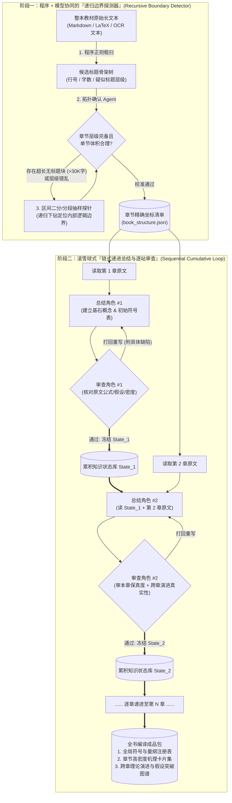

# 理工科教材递归探界与链式递进编译引擎（独立项目方案 · Draft v0.1）

> **项目定位**：一个独立于下游问答合成的**教材知识编译系统（Textbook Knowledge Compiler）**。
> **核心思想**：摒弃传统的“固定字数切块 + 孤立并行摘要”模式，顺应理工科教材“公理演进、层层打破理想假设、符号前后高度耦合”的天然拓扑结构，采用 **“程序/模型协同递归探界 $\rightarrow$ 滚雪球式链式递进总结 $\rightarrow$ 逐站独立审查闸门”**，将一本几十万字的教材编译成一份**自带因果演进图谱、统一符号注册表与高密度机理卡片**的结构化知识库。

---

## 1. 为什么传统“切片并行总结”会毁掉理工科教材？

如果把一本《流体力学》或《自动控制原理》按章或按固定 Token 切成 20 块，同时发给 20 个并发模型做总结，会产生三大结构性失真：

1. **演进脉络断裂（丢失“为什么要有这一章”）**：
   - 理工科教材的核心逻辑往往是：**第 1–2 章建立最简理想模型（如无粘流体、线性时不变系统） $\rightarrow$ 第 4–5 章引入现实物理约束（如边界层粘性、频域谐振） $\rightarrow$ 第 7–8 章解决极端工况或非线性失效（如湍流工程经验公式、非线性自激振荡）**。
   - 孤立总结第 7 章时，模型只知道抄写第 7 章的公式，却提炼不出**“当第 2 章的哪个假设在现实中失效时，必须切换至第 7 章的方法”**。
2. **符号体系失控（同名异义与未定义引用）**：
   - 第 6 章的公式里直接用了第 1 章定义的基准变量或无量纲数（如 $Re, Pr, \eta$），或者前章用 $E$ 表示弹性模量、后章用 $E$ 表示电场强度。孤立总结会导致符号含义丢失或跨章冲突。
3. **误差无阻尼放大**：
   - 没有逐章审查机制的总结会把 OCR 识别错误的公式、漏抄的边界条件直接固化进知识库，成为后续所有应用（检索、出题、RAG、微调）的“毒源”。

---

## 2. 系统总体架构：两阶段流水线（探界 + 链式递进编译）

本系统由两大核心子系统构成：**阶段一（递归边界探测器）**负责把脏乱的教材长文本切分成精准的逻辑章节树；**阶段二（链式递进总结与逐站审查机）**负责从第 1 章到第 $N$ 章滚雪球式地编译知识并逐站锁死质量。



---

## 3. 阶段一详解：递归边界探测器（Recursive Boundary Detector）

现实中的教材转写稿往往格式不规范（如标题没打 `#`、把例题里的“1.2 求解步骤”误判为第 1.2 节、或者某一大章长达 8 万字没有任何显式子标题）。直接按字数硬切会劈开公式推导。

### 3.1 递归探界三步法

1. **Level 0：程序零成本骨架扫描（Programmatic Skeleton Scan）**
   - Python/Node 脚本按行扫描整本书，提取所有候选锚点（Markdown 标题 `#`、`第[一二三四五六七八九十\d]+[章节篇]`、`Chapter/Section`、独立成行的数字编号 `^\d+\.\d+\s+`），记录其 `line_number`、前后段落空行特征及区间字符数。
   - **保护区标记**：同时用状态机标记所有的 LaTeX 公式块（`$$...$$`、`\begin{equation}`）、代码块与表格区间，声明这些区间**严禁被作为切分边界**。

2. **Level 1：全局目录树校准（Global TOC Calibration）**
   - 将提取出的几百行《候选标题骨架》发给 **Boundary-Agent**。
   - Agent 过滤掉伪标题（如“例 2.1”、“表 3-2”、“习题”），识别出真正的 `章 (Chapter) -> 节 (Section)` 二级结构，并输出每一章的起止行号 `[start_line, end_line]`。

3. **Level 2：异常区间的递归下钻探针（Recursive Zoom-in Probe）**
   - 程序自动检查 Level 1 输出的每个章节区间：
     - **触发条件 A（体积过大）**：某章/节跨度超过设定阈值（如 `> 25,000` 字），且内部没有识别出子节；
     - **触发条件 B（跨度异常）**：相邻两个节编号跳跃（如从 `2.1` 直接跳到 `2.5`，说明中间的标题因 OCR 格式丢失被漏扫）。
   - **递归操作**：程序仅针对该异常区间 `[L_start, L_end]`，按每 2,000 字抽取首尾段落或提取所有短行，交由 **Boundary-Agent** 在该局部区间内二次定位漏掉的节标题或自然逻辑分界点（如“基本方程推导段”、“工程修正段”、“典型例题段”），直至所有叶子节点都在理想的阅读窗口（如 `3,000 ~ 15,000` 字）内。

### 3.2 阶段一产出物：`book_structure.json`
```json
{
  "book_id": "FLUID_MECH_01",
  "title": "工程流体力学",
  "chapters": [
    {
      "chapter_index": 1,
      "chapter_id": "Ch01",
      "title": "流体及其主要物理性质",
      "start_line": 45,
      "end_line": 1280,
      "char_count": 14200,
      "sections": [
        { "section_id": "Ch01_Sec01", "title": "流体的连续介质假设", "start_line": 45, "end_line": 410 },
        { "section_id": "Ch01_Sec02", "title": "流体的压缩性与粘性", "start_line": 411, "end_line": 1280 }
      ]
    }
  ]
}
```

---

## 4. 阶段二详解：滚雪球式“链式递进总结”机制

拿到精确的章节坐标后，系统启动**有状态的单书串行循环**（注：不同教材之间可完全并行）。

### 4.1 为什么不直接喂“前 $k-1$ 章的全文”，而是喂“前 $k-1$ 章的冻结状态库 + 第 $k$ 章全文”？

如果让第 2 个角色读“第 1 章全文 + 第 2 章全文”，那么到第 12 章时，他要同时读 12 章的原文（可能高达 30 万～50 万字）。这不仅极其烧钱，而且大模型的“中间迷失（Lost-in-the-Middle）”效应会导致它反而看不清当前第 12 章的细节。

因此，最精妙的设计是**把“前 $k-1$ 章的阅读记忆”固化为一个不断生长、且每一站都经过严格审查的《累积知识状态库》（Cumulative State, `State_{k-1}`）**：

- **第 1 个总结角色（Summarizer #1）**：
  - **输入**：`第 1 章完整原文`
  - **任务**：提炼第 1 章的核心概念、公理假设、基础方程，并初始化《全书统一符号表》，产出 `Draft_State_1`。
- **第 2 个总结角色（Summarizer #2）**：
  - **输入**：经审查冻结的 `State_1`（第 1 章的高密度结构化精华） + `第 2 章完整原文`
  - **任务**：
    1. 站在第 1 章的基础上阅读第 2 章，提取第 2 章自身的机理卡片；
    2. **建立跨章演进边（Evolution Edges）**：明确指出第 2 章调用了第 1 章的哪个概念/公式，或者打破、具体化了第 1 章的哪个假设；
    3. 将第 2 章新增的物理量符号追加并对齐到《全书统一符号表》，产出 `Draft_State_2`。
- **第 $k$ 个总结角色（Summarizer #$k$）**：
  - **输入**：经审查冻结的 `State_{k-1}`（包含第 $1 \sim k-1$ 章的全书演进脉络、符号表与各章核心卡片） + `第 k 章完整原文`
  - **任务**：同上，完成第 $k$ 章的知识提取，并与前 $k-1$ 章中的**任意相关章节**建立跨章耦合与演进连接，产出 `Draft_State_k`。

> **特殊优化（相邻章双原文模式）**：如果第 $k$ 章与第 $k-1$ 章联系极其紧密（例如“上篇：基本方程推导”与“下篇：方程求解与应用”），可以在输入中同时挂载 **`State_{k-2}` + `第 k-1 章完整原文` + `第 k 章完整原文`**，做到既看清紧邻上一章的每一个推导细节，又握有前序所有章节的全局地图！

---

### 4.2 累积状态库 `State_k` 的三层核心数据结构

每一次递进，`State_k` 都在更新和生长以下三个核心模块：

#### 模块一：《全书统一符号与量纲注册表》（Global Symbol Registry）
防止前后章节符号打架：
```yaml
symbols:
  - symbol: "\\tau"
    meaning: "切应力 (Shear Stress)"
    si_unit: "Pa (N/m^2)"
    first_defined_in: "Ch01_Sec02"
    disambiguation: "注意与 Ch05 中的时间常数 \\tau 区分"
  - symbol: "Re"
    meaning: "雷诺数 (Reynolds Number, \\rho v d / \\mu)"
    si_unit: "无量纲 (1)"
    first_defined_in: "Ch04_Sec01"
```

#### 模块二：《跨章理论演进与假设突破图谱》（Cross-Chapter Evolution Graph）—— **本方案最核心的资产**
专门记录“后一章是如何推翻、修正、扩展或组合前几章的”：
```yaml
evolution_edges:
  - from_chapter: "Ch03 (理想流体伯努利方程)"
    to_chapter: "Ch04 (粘性流体管内流动与水头损失)"
    evolution_type: "ASSUMPTION_RELAXATION (放宽理想假设)"
    what_changed: "打破了 Ch03 中『无粘性、无机械能损耗 (\\mu = 0)』的理想假设，引入沿程阻力损失 h_f (达西-魏斯巴赫公式) 与局部水头损失 h_m。"
    real_world_trigger: "当管道长径比 L/d 较大、管壁粗糙或存在阀门弯头时，直接用 Ch03 理想伯努利方程会导致出口压力严重高估，必须切换到 Ch04 的能量修正方程。"
```

#### 模块三：《本章高密度机理与工程边界卡片》（Chapter Knowledge Cards）
每个章节提炼出的核心硬核内容：
- **核心控制方程与推导起点**：LaTeX 精确公式 + 该公式是从前哪一章的哪个定律推导出来的。
- **严苛适用边界（Assumptions & Validity）**：公式成立的定量/定性前提（如 $Ma < 0.3$、线弹性小变形、稳态导热），以及**一旦越界会发生什么物理失效**。
- **典型例题解题范式（Problem-Solving Blueprints）**：从本章例题中抽离出的标准求解步骤（输入什么 $\rightarrow$ 查什么表/用什么方程 $\rightarrow$ 校验什么条件）。

---

## 5. 逐站审查机制：每一章的审查角色（Critic #$k$）如何守门？

在链式递进架构中，**“每一次都要审查”是整个系统不崩盘的生命线**。如果第 2 章混入了一个错误公式或遗漏了一个关键概念，第 3 到第 20 章都会在错误的基础上继续推理。

因此，每当 `Summarizer #k` 生成 `Draft_State_k` 后，必须立刻交由独立的 **`Critic #k`**（同样持有 `State_{k-1}` + `第 k 章完整原文` + `Draft_State_k`）执行 **5 维硬核审查**：

| 审查维度 | 审查官（Critic #$k$）核查的具体问题 | 触发打回（`REVISE`）的红线情形 |
| :--- | :--- | :--- |
| **1. 完备性审查 (Completeness)** | 对照第 $k$ 章原文，是否有核心定理、关键分支工况或重要工程经验公式被总结角色漏掉了？ | 漏掉本章任意一个带编号的核心主方程，或漏掉整节的关键结论。 |
| **2. 公式与假设保真度 (Fidelity)** | 总结中的 LaTeX 公式正负号、上下标是否与原文 100% 一致？公式对应的**成立假设/适用范围**有没有被抄丢？ | 公式符号抄错，或者只抄了公式却没写该公式的适用前提（把有条件公式写成了普适真理）。 |
| **3. 跨章演进真实性 (Evolution Validity)** | 总结角色写的 `Ch_m -> Ch_k` 演进关系，在原文中是否有真实的物理/数学逻辑支撑？有没有漏掉明显的跨章递进？ | 强行脑补毫无关系的跨章联系；或者原文明明写了“基于第 2 章的式(2-5)修正得到……”，总结里却没建这条演进边。 |
| **4. 符号一致性 (Symbol Hygiene)** | 本章新出现的符号是否都已登记？如果与前 $k-1$ 章的符号重名但物理意义不同，是否做了冲突消歧标注？ | 出现未定义物理量符号，或与前章同名符号混用未标注。 |
| **5. 信息密度与体积门控 (Density & Budget)** | 是否存在“本章介绍了……”等教材目录式废话？本章新增状态体积是否控制在预算（如 1,500–3,000 Tokens）内？ | 写成空洞的文字概述，缺乏定量公式与边界条件；或单章冗长导致后续滚雪球超长。 |

### 审查闭环状态机（最多重试 $M=3$ 次）
- 如果 `Critic #k` 返回 **`REJECT / REVISE`**：必须输出结构化的《缺陷清单（Defect List）》（指明原文行号、漏掉的公式、写错的跨章边），打回给 `Summarizer #k` 针对性修正，修正后再次过审。
- 如果 `Critic #k` 返回 **`PASS`**：系统将 `Draft_State_k` 计算 SHA-256 签名并**持久化锁死为不可变的 `Frozen_State_k`**，作为下一章 `Summarizer #(k+1)` 的唯一合法输入（完美支持任意章节断点续跑！）。

---

## 6. 进阶扩展：当全书特别厚（如 > 25 章）时的“分篇层级滚动”

如果遇到一本巨厚无比的鸿篇巨著（例如 30 章、100 万字的《机械设计手册》或《高等工程数学》），即使每章只沉淀 2,000 Tokens，滚到第 25 章时 `State_24` 也会达到 50K Tokens。为保持模型注意力高度集中，可以引入**两级滚雪球（Part-level Consolidation）**：

1. **章内/篇内细滚**：第 1～5 章（第一篇：静力学篇）按上述流程逐章携带完整卡片递进；
2. **篇末收敛审查（Milestone Compaction）**：当第一篇结束时，由专门的 **Consolidator Agent + Critic** 将第 1～5 章的状态压制成一份超精炼的《第一篇基石接口快照》（只保留供后续篇章调用的核心定理、符号与边界，折叠具体例题细节），同时将第 1～5 章的完整细粒度卡片归档落盘；
3. **跨篇轻装前进**：读第 6 章（第二篇：动力学篇）时，携带《第一篇基石接口快照》+ 第二篇内部已读章节的完整卡片继续滚雪球。

---

## 7. 项目独立目录结构与数据持久化设计

如果将本方案作为独立项目（例如命名为 `textbook-compiler`）开发，推荐采用极简、可断点续跑的目录与 SQLite/JSON 状态存储：

```text
textbook-compiler/
├── data/
│   ├── raw_books/                  # 存放待编译的教材 Markdown / LaTeX 原文
│   └── compiler.sqlite             # 核心状态库（支持任意章节中断后无缝续跑）
├── prompts/
│   ├── 01_boundary_detector.md     # 递归探界与目录树校准 Prompt
│   ├── 02_sequential_summarizer.md # 携带前序 State_{k-1} 的递进总结 Prompt
│   └── 03_chapter_critic.md        # 5 维硬核审查官 Prompt
├── src/
│   ├── detector/
│   │   ├── skeleton-scanner.ts     # 程序正则粗扫行号、字数与公式保护区
│   │   └── recursive-prober.ts     # 模型拓扑确认与超长区间递归下钻
│   ├── compiler/
│   │   ├── sequential-runner.ts    # Ch1 -> ChN 串行状态机与重试循环
│   │   ├── state-merger.ts         # 增量合并符号表、演进图谱与章节卡片
│   │   └── critic-gate.ts          # 审查解析与 PASS/REVISE 闸门
│   └── exporter/
│       └── export-knowledge-pkg.ts # 导出全书知识图谱 (YAML / JSON / Markdown)
└── output/
    └── <book_id>/
        ├── book_structure.json     # 阶段一产出的精确章节行号范围
        ├── states/                 # 每一章冻结的历史快照 (state_ch01.json ... state_chN.json)
        └── compiled_textbook.yaml  # 最终全书编译成品（可直接喂入 600K 缓存或下游任务）
```

### 核心状态表（`compiler.sqlite`）只需 4 张表：
1. **`books`**：记录教材基本信息、原始文件路径、总行数、当前所处阶段（`detecting | compiling | completed`）。
2. **`chapter_boundaries`**：阶段一探界产出的每一章/节的精确 `[start_line, end_line]`、字数及树状父子关系。
3. **`chapter_compilations`**：记录每一章的当前状态（`pending | summarizing | reviewing | frozen | failed`）、当前固化下来的 `frozen_state_json`（即 `State_k`），天然支持**跑到第 8 章断电后直接从第 8 章恢复**。
4. **`review_attempts`**：完整记录每一章每一次 `Summarizer` 的草稿与 `Critic` 的审查意见（`pass | revise` 及具体抓出的公式/假设缺陷），既用于审计总结质量，也能直观看到审查官帮每本书揪出了多少潜在错误。
